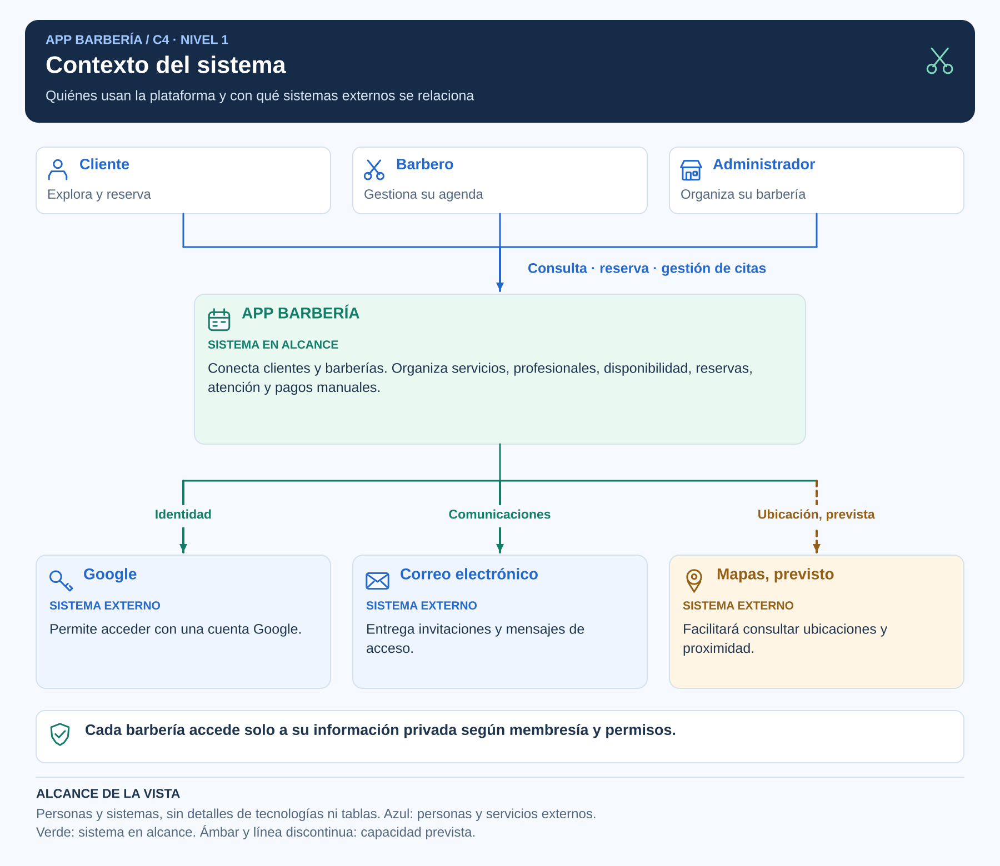

# App Barbería: primer sprint de arquitectura

| Dato | Información |
|---|---|
| Estudiante | Erwin Brayam Inca Pauccara |
| Curso | Arquitectura de Software - Semestre 2026-II |
| Entrega | Análisis, arquitectura y diseño de software - Semanas 4, 5 y 6 |

## Propuesta

App Barbería permitirá explorar establecimientos, consultar servicios y profesionales y programar una atención. Los barberos organizarán su agenda y los administradores gestionarán la operación de su establecimiento.

El problema que se busca resolver es la dificultad para conocer disponibilidad y coordinar citas, que puede generar esperas y cruces de atención en Ayacucho-Huamanga.

La solución será cliente-servidor, con tres capas lógicas, módulos por funcionalidad y Supabase como backend administrado. Se utilizarán Expo/React Native, TypeScript, Supabase Auth y PostgreSQL, con contratos y adaptadores según Clean Architecture.

Varias barberías compartirán infraestructura, con acceso privado limitado por usuario, recurso y membresía. Efectivo y Yape tendrán confirmación manual; no se incluye una pasarela automática, facturación fiscal o ERP. Reseñas, mapas y carga multimedia se incorporarán por etapas.

## Vista del sistema



Esta vista muestra personas y sistemas. La [arquitectura inicial](docs/02-arquitectura-software/arquitectura-inicial.md) desarrolla las capas y responsabilidades. Los diagramas se incluyen únicamente en SVG para mantener nitidez al ampliarlos.

## Documentación

| Bloque | Archivos y propósito |
|---|---|
| Análisis del sistema | [Necesidad](docs/01-analisis-de-sistema/00-necesidad-del-negocio.md), [actores](docs/01-analisis-de-sistema/01-actores.md), [historias](docs/01-analisis-de-sistema/02-historias-de-usuario.md) y [requisitos](docs/01-analisis-de-sistema/03-requisitos-funcionales.md): problema, participantes y funciones. |
| Calidad y condiciones | [Atributos](docs/01-analisis-de-sistema/04-atributos-de-calidad.md), [restricciones](docs/01-analisis-de-sistema/05-restricciones.md) y [escenarios](docs/01-analisis-de-sistema/08-escenarios-atributos-calidad.md): criterios y medidas propuestas. |
| Justificación arquitectónica | [Drivers](docs/01-analisis-de-sistema/06-drivers-arquitectonicos.md) y [decisiones](docs/01-analisis-de-sistema/07-decisiones-arquitectonicas.md): por qué se elige cada solución. |
| Arquitectura | [Inicial](docs/02-arquitectura-software/arquitectura-inicial.md), [estilo](docs/02-arquitectura-software/estilo-arquitectonico.md), [enfoque](docs/02-arquitectura-software/enfoque-arquitectonico.md) y [componentes](docs/02-arquitectura-software/componentes-arquitectonicos.md): estructura y colaboración. |
| Diseño de software | [Diseño interno](docs/03-diseño-de-software/diseño-interno/diseño-interno-de-modulos.md), [patrones](docs/03-diseño-de-software/diseño-interno/patrones-de-diseño.md) y [SOLID](docs/03-diseño-de-software/diseño-interno/principios-de-diseño.md): detalle del flujo CrearReserva. |
| Modelo C4 | [C1: contexto](docs/04-modelo-c4/Nivel1-DiagramadeContextodelSistema.md), [C2: contenedores](docs/04-modelo-c4/Nivel2-DiagramadeContenedores.md), [C3: componentes](docs/04-modelo-c4/Nivel3-Diagrama-de-Componentes.md) y [C4: código](docs/04-modelo-c4/Nivel4-DiagramadeCodigo.md): vistas de mayor a menor alcance. |
| Tecnología | [Demostración de reservas](tecnologia/barberia-clean-architecture/README.md): caso de uso, contrato, adaptador, pruebas y tres resultados simulados. |

## Organización del repositorio

```text
.
├── docs/
│   ├── 01-analisis-de-sistema/       Necesidad, requisitos, calidad, ADR y escenarios
│   ├── 02-arquitectura-software/    Capas, estilo, enfoque y componentes
│   ├── 03-diseño-de-software/
│   │   └── diseño-interno/         Módulo, patrones y principios
│   └── 04-modelo-c4/               Contexto, contenedores, componentes y código
├── img/                           Diagramas SVG
├── tecnologia/
│   └── barberia-clean-architecture/ Demostración mínima en TypeScript
├── .gitignore
└── README.md
```

## Ejecutar la demostración

Con Node.js 22.18 o superior y npm, desde la carpeta del ejemplo:

```bash
cd tecnologia/barberia-clean-architecture
npm ci
npm run check
npm test
npm run demo
```

La demo simula respuestas RPC y no requiere credenciales. Muestra reserva confirmada, horario ocupado y selección incompleta. Node se utiliza para ejecutar el ejemplo; el backend propuesto es Supabase.

Las pruebas verifican el código y el contrato del ejemplo. Seguridad, concurrencia y capacidad del backend deberán evaluarse con los escenarios definidos; las metas de calidad no se presentan como resultados medidos.

## Recorrido para exponer en 12 minutos

| Tiempo | Qué explicar |
|---|---|
| 2 minutos | Problema, usuarios y requisitos principales. |
| 2 minutos | Drivers y decisiones: Supabase, aislamiento y transacciones. |
| 3 minutos | C1, C2 y C3: sistema, servicios y componentes. |
| 2 minutos | C4, patrones y SOLID del flujo de reserva. |
| 2 minutos | Demostración: éxito, conflicto y entrada inválida. |
| 1 minuto | Escenarios de calidad y alcance previsto. |

Cada componente se relaciona con sus requisitos en el documento correspondiente. La entrega se realiza mediante la URL del repositorio y su exposición.

## Referencia de clase

La organización sigue la Guía 04 y el [repositorio de la profesora](https://github.com/devlizbethjaico/Marketplace-arquitSoft-02). Se conserva un [fork de referencia](https://github.com/ErwinB23/Marketplace-arquitSoft-02). Los contenidos y diagramas de este repositorio corresponden a App Barbería.
