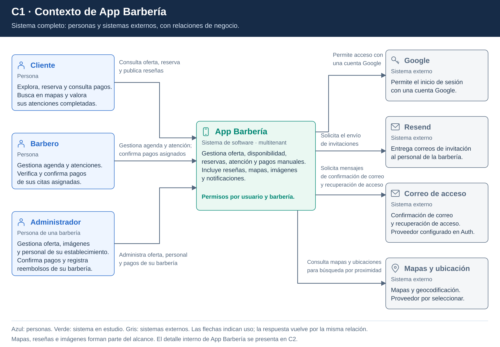

# Sistema multitenant de barberías · App Barbería

| Dato | Información |
|---|---|
| Estudiante | Erwin Brayam Inca Pauccara |
| Curso | Arquitectura de Software · Semestre 2026-II |
| Entrega | Análisis, arquitectura y diseño de software · Semanas 4, 5 y 6 |

## Propuesta

App Barbería busca facilitar la consulta de servicios y horarios y la reserva de atenciones en Ayacucho-Huamanga. El cliente explora establecimientos y gestiona sus citas; el barbero organiza su agenda y atiende reservas; el administrador gestiona su barbería. Varias barberías utilizarán la misma plataforma, con acceso privado controlado por usuario, recurso y membresía.

El alcance incluye catálogo, disponibilidad, reservas, atención, pagos manuales, invitaciones, notificaciones internas, reseñas, ubicación y mapas, y gestión de imágenes. Las funcionalidades pueden entregarse por etapas, pero cada una seguirá la arquitectura definida desde su primera implementación. Efectivo y Yape se registrarán como medios de pago; el barbero asignado o un administrador autorizado confirmará manualmente su recepción. La propuesta no incluye pasarela de cobro, verificación automática de Yape, facturación fiscal ni ERP.

## Arquitectura elegida

- **Estilo:** cliente-servidor con tres capas lógicas: presentación, aplicación y negocio, y datos y archivos. Los módulos se organizan por funcionalidad dentro de una misma solución.
- **Enfoque interno:** Clean Architecture desde el inicio en cliente y servidor. Los casos de uso dependen de tipos y contratos propios; presentación e infraestructura se conectan al núcleo mediante esos contratos.
- **Tecnologías propuestas:** Expo, React Native, Expo Router y TypeScript para móvil y acceso web; Supabase Auth, Edge Functions, API de datos, PostgreSQL y Storage para el backend administrado. Google proporciona identidad; un servicio de correo entrega invitaciones y mensajes de acceso. El proveedor de mapas se seleccionará al implementar esa integración.
- **Datos y seguridad:** PostgreSQL y su esquema son compartidos entre barberías. Las relaciones por establecimiento, membresías, RLS, permisos de servidor y restricciones de integridad protegen datos y operaciones. Storage guarda los archivos de imagen; PostgreSQL conserva sus rutas y metadatos.

Las consultas autorizadas podrán realizarse por HTTPS y REST. Para confirmar una reserva, el cliente invoca una Edge Function por HTTPS; el caso de uso del servidor verifica la sesión y coordina la operación. Su adaptador invoca mediante PostgREST RPC una función PostgreSQL que vuelve a comprobar permisos y disponibilidad y guarda las escrituras relacionadas en una transacción. La consulta previa de horarios solo orienta al cliente: la confirmación se decide con los datos vigentes en el servidor.



## Documentación

| Carpeta | Contenido |
|---|---|
| [01 · Análisis del sistema](docs/01-analisis-de-sistema/00-necesidad-del-negocio.md) | Necesidad del negocio, actores, historias, requisitos, atributos de calidad, restricciones, drivers, decisiones y [escenarios de evaluación](docs/01-analisis-de-sistema/08-escenarios-atributos-calidad.md). |
| [02 · Arquitectura de software](docs/02-arquitectura-software/arquitectura-inicial.md) | Arquitectura inicial, [estilo](docs/02-arquitectura-software/estilo-arquitectonico.md), [enfoque Clean Architecture](docs/02-arquitectura-software/enfoque-arquitectonico.md) y [componentes](docs/02-arquitectura-software/componentes-arquitectonicos.md). |
| [03 · Diseño de software](docs/03-diseño-de-software/diseño-interno/diseño-interno-de-modulos.md) | Diseño interno del módulo Reservas, [patrones](docs/03-diseño-de-software/diseño-interno/patrones-de-diseño.md) y [principios](docs/03-diseño-de-software/diseño-interno/principios-de-diseño.md). |
| 04 · Modelo C4 | [C1 · Contexto](docs/04-modelo-c4/Nivel1-DiagramadeContextodelSistema.md) → [C2 · Contenedores](docs/04-modelo-c4/Nivel2-DiagramadeContenedores.md) → [C3 · Componentes móviles](docs/04-modelo-c4/Nivel3-Diagrama-de-Componentes.md) → [C4 · Código de Coordinación de reservas](docs/04-modelo-c4/Nivel4-DiagramadeCodigo.md). |
| [Tecnología · Demostración técnica](tecnologia/barberia-clean-architecture/README.md) | Flujo de reserva separado en cliente y servidor, con contratos y servicios simulados. |

Los diagramas están en `img/` como SVG para que puedan ampliarse. C1 muestra el límite del sistema; C2, sus aplicaciones y servicios; C3, el interior de la aplicación móvil para una reserva; C4, el diseño de código de su coordinación. La secuencia de C4 añade el orden de las llamadas hasta PostgreSQL.

## Ejemplo técnico incluido

La carpeta `tecnologia/barberia-clean-architecture/` contiene una **demostración local** del flujo elegido: `SolicitarReserva` y `ReservaHttpAdapter` en el cliente; entrada HTTP, `ConfirmarReserva` y `PostgresReservaAdapter` en el servidor. El transporte, la sesión y la RPC se simulan en memoria. Sirve para mostrar las responsabilidades y la dirección de las dependencias, sin afirmar que exista un backend Supabase operativo.

Para ejecutar el ejemplo, se necesita Node.js 22.18 o superior y npm. Desde la raíz del repositorio:

```bash
cd tecnologia/barberia-clean-architecture
npm ci
npm run check
npm test
npm run demo
```

`npm run check` comprueba los tipos; `npm test` ejecuta las pruebas locales; `npm run demo` muestra tres respuestas simuladas. Node.js ejecuta este ejemplo y las herramientas de prueba; la arquitectura propuesta usa Supabase como backend. Seguridad, concurrencia, rendimiento y disponibilidad requieren las pruebas de integración y medición descritas en los [escenarios de calidad](docs/01-analisis-de-sistema/08-escenarios-atributos-calidad.md). Sus metas aún no son resultados medidos.

## Implementación funcional — BARBEXA

La propuesta, el análisis, los requerimientos, la arquitectura, el diseño, los diagramas C4 y la demostración simulada anteriores corresponden a la etapa académica inicial y se conservan como antecedentes. Su implementación funcional actual se desarrolla de forma independiente en **[BARBEXA](https://github.com/ErwinB23/barbexa)**, una plataforma SaaS multitenant para clientes, barberos y administradores de distintas barberías.

**Acceso:** el repositorio funcional es **privado** y requiere autorización del responsable. Sus enlaces de código, historial, documentación y CI solo podrán consultarse con una cuenta autorizada; no constituyen un despliegue público.

### Implementación y alcance actual

- **Tecnologías utilizadas:** Expo, React Native, Expo Router, React y TypeScript en el cliente Web; Supabase Auth, Edge Functions con Deno, PostgREST y PostgreSQL en el backend administrado. Efectivo y Yape tienen registro y confirmación manual autorizada, sin verificación automática de cobros. El [manifiesto del proyecto](https://github.com/ErwinB23/barbexa/blob/main/package.json) identifica las dependencias reales.
- **Arquitectura y metodología:** Clean Architecture modular por funcionalidad en cliente y servidor, con dominio y aplicación independientes de frameworks, puertos y adaptadores, aislamiento por barbería y autorización definitiva en servidor. Se utiliza SDD (Spec-Driven Development) con Spec Kit y [especificaciones versionadas](https://github.com/ErwinB23/barbexa/tree/main/specs).
- **Estado Web:** interfaces y recorrido funcional manual aprobados para cliente, trabajador barbero, trabajador con permisos administrativos y propietario administrador/barbero. Incluye reservas y reprogramación, agendas, atención, registro manual de pagos, notificaciones, invitaciones y administración de barberías, equipo, servicios y horarios. El estado publicado en este cierre contiene **23 commits**, hasta `a758dfa`; su evolución puede consultarse en el [historial de commits](https://github.com/ErwinB23/barbexa/commits/main/).
- **Contratos REST:** [OpenAPI](https://github.com/ErwinB23/barbexa/blob/main/docs/api/openapi.json) y [visor Swagger UI local](https://github.com/ErwinB23/barbexa/blob/main/docs/api/index.html). El visor se inicia desde el repositorio funcional con `npm run docs:api`, en `127.0.0.1:8082` por defecto, y mantiene deshabilitada la ejecución interactiva de operaciones.
- **Verificación y persistencia:** [pruebas automatizadas Node y Deno](https://github.com/ErwinB23/barbexa/tree/main/tests), controles de tipos, lint, formato, arquitectura y cobertura; [migraciones SQL versionadas](https://github.com/ErwinB23/barbexa/tree/main/supabase/migrations) para el esquema y las reglas de base de datos. Enlazar las migraciones no supone ejecutarlas.

### Evidencia de integración continua y pendientes

La [primera ejecución exitosa de GitHub Actions](https://github.com/ErwinB23/barbexa/actions/runs/45696792837), correspondiente a `a758dfa`, duró **11 minutos y 48 segundos**. Aprobó la instalación reproducible con `npm ci`, el control `npm run check`, la cobertura, la validación OpenAPI y la exportación Web. Publicó el artefacto **quality-evidence** con evidencias agregadas sanitizadas; su descarga está sujeta a los permisos del repositorio y a la retención de Actions.

**Mantenimiento técnico pendiente:** actualizar las acciones que todavía utilizan el runtime Node.js 20, por la advertencia no bloqueante de GitHub Actions. Esta advertencia corresponde al runtime de esas acciones; el workflow actual no se modifica en esta vinculación.

Este cierre acredita el alcance Web y la CI indicada. **No declara completados Android, la entrega o el despliegue continuos (CD), un despliegue público, las pruebas de carga ni la evaluación de todos los atributos de calidad.** Sus validaciones y las integraciones pendientes mantienen su alcance propio.

Los repositorios académico y funcional conservan historiales independientes: esta sección solo los vincula mediante referencias, sin duplicar código, fusionar historiales ni añadir submódulos.
