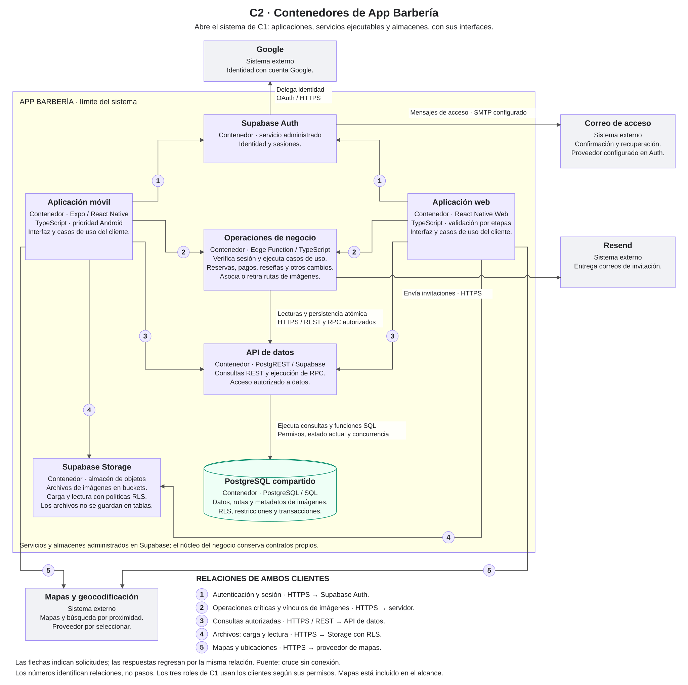

# Sistema multitenant de barberías · App Barbería

| Dato | Información |
|---|---|
| Estudiante | Erwin Brayam Inca Pauccara |
| Curso | Arquitectura de Software · Semestre 2026-II |
| Entrega | Análisis, arquitectura y diseño de software · Semanas 4, 5 y 6 |

## Propuesta

App Barbería busca facilitar la consulta de servicios y horarios y la reserva de atenciones en Ayacucho-Huamanga. El cliente explora establecimientos y gestiona sus citas; el barbero organiza su agenda y atiende reservas; el administrador gestiona su barbería. Varias barberías utilizarán la misma plataforma, con acceso privado controlado por usuario, recurso y membresía.

El alcance incluye catálogo, disponibilidad, reservas, atención, pagos manuales, invitaciones, notificaciones internas, reseñas, ubicación y mapas, y gestión de imágenes. Las funcionalidades pueden entregarse por etapas, pero cada una seguirá la arquitectura definida desde su primera implementación. Efectivo y Yape se registrarán como medios de pago; el barbero asignado o un administrador autorizado confirmará manualmente su recepción. La propuesta no incluye pasarela de cobro, verificación automática de Yape, facturación fiscal ni ERP.

## Arquitectura elegida

- **Estilo:** cliente-servidor con tres capas lógicas: presentación, aplicación y negocio, y datos y archivos. Los módulos se organizan por funcionalidad dentro de una misma solución.
- **Enfoque interno:** Clean Architecture desde el inicio en cliente y servidor. Los casos de uso dependen de tipos y contratos propios; presentación e infraestructura se conectan al núcleo mediante esos contratos.
- **Tecnologías propuestas:** Expo, React Native, Expo Router y TypeScript para móvil y acceso web; Supabase Auth, Edge Functions, API de datos, PostgreSQL y Storage para el backend administrado. Google proporciona identidad; un servicio de correo entrega invitaciones y mensajes de acceso. El proveedor de mapas se seleccionará al implementar esa integración.
- **Datos y seguridad:** PostgreSQL y su esquema son compartidos entre barberías. Las relaciones por establecimiento, membresías, RLS, permisos de servidor y restricciones de integridad protegen datos y operaciones. Storage guarda los archivos de imagen; PostgreSQL conserva sus rutas y metadatos.

Las consultas autorizadas podrán realizarse por HTTPS y REST. Para confirmar una reserva, el cliente invoca una Edge Function por HTTPS; el caso de uso del servidor verifica la sesión y coordina la operación. Su adaptador invoca mediante PostgREST RPC una función PostgreSQL que vuelve a comprobar permisos y disponibilidad y guarda las escrituras relacionadas en una transacción. La consulta previa de horarios solo orienta al cliente: la confirmación se decide con los datos vigentes en el servidor.


## Documentación

| Carpeta | Contenido |
|---|---|
| [01 · Análisis del sistema](docs/01-analisis-de-sistema/00-necesidad-del-negocio.md) | Necesidad del negocio, actores, historias, requisitos, atributos de calidad, restricciones, drivers, decisiones y [escenarios de evaluación](docs/01-analisis-de-sistema/08-escenarios-atributos-calidad.md). |
| [02 · Arquitectura de software](docs/02-arquitectura-software/arquitectura-inicial.md) | Arquitectura inicial, [estilo](docs/02-arquitectura-software/estilo-arquitectonico.md), [enfoque Clean Architecture](docs/02-arquitectura-software/enfoque-arquitectonico.md) y [componentes](docs/02-arquitectura-software/componentes-arquitectonicos.md). |
| [03 · Diseño de software](docs/03-diseño-de-software/diseño-interno/diseño-interno-de-modulos.md) | Diseño interno del módulo Reservas, [patrones](docs/03-diseño-de-software/diseño-interno/patrones-de-diseño.md) y [principios](docs/03-diseño-de-software/diseño-interno/principios-de-diseño.md). |
| 04 · Modelo C4 | [C1 · Contexto](docs/04-modelo-c4/Nivel1-DiagramadeContextodelSistema.md) → [C2 · Contenedores](docs/04-modelo-c4/Nivel2-DiagramadeContenedores.md) → [C3 · Componentes móviles](docs/04-modelo-c4/Nivel3-Diagrama-de-Componentes.md) → [C4 · Código de Coordinación de reservas](docs/04-modelo-c4/Nivel4-DiagramadeCodigo.md). |
| [Tecnología · Demostración técnica](tecnologia/barberia-clean-architecture/README.md) | Flujo de reserva separado en cliente y servidor, con contratos y servicios simulados. |

Los diagramas están en `img/` como SVG para que puedan ampliarse. C1 muestra el límite del sistema; C2, sus aplicaciones y servicios; C3, el interior de la aplicación móvil para una reserva; C4, el diseño de código de su coordinación. La secuencia de C4 añade el orden de las llamadas hasta PostgreSQL.

## Ejemplo técnico incluido

La carpeta `tecnologia/barberia-clean-architecture/` contiene una **demostración local** del flujo elegido: `SolicitarReserva` y `ReservaHttpAdapter` en el cliente; entrada HTTP, `ConfirmarReserva` y `PostgresReservaAdapter` en el servidor. El transporte, la sesión y la RPC se simulan en memoria. Sirve para mostrar las responsabilidades y la dirección de las dependencias, sin afirmar que exista un backend Supabase operativo.

Para ejecutar el ejemplo, se necesita Node.js 22.18 o superior y npm. Desde la raíz del repositorio:

```bash
cd tecnologia/barberia-clean-architecture
npm ci
npm run check
npm test
npm run demo
```

`npm run check` comprueba los tipos; `npm test` ejecuta las pruebas locales; `npm run demo` muestra tres respuestas simuladas. Node.js ejecuta este ejemplo y las herramientas de prueba; la arquitectura propuesta usa Supabase como backend. Seguridad, concurrencia, rendimiento y disponibilidad requieren las pruebas de integración y medición descritas en los [escenarios de calidad](docs/01-analisis-de-sistema/08-escenarios-atributos-calidad.md). Sus metas aún no son resultados medidos.

## Implementación funcional — BARBEXA

### Sprint 2 · guía de sustentación

**[Abrir BARBEXA público](https://github.com/ErwinB23/barbexa)** · SaaS multitenant para clientes, barberos y administradores: reservas, agendas, atención y pagos manuales. La propuesta académica del Sprint 1 se conserva arriba; esta sección muestra la implementación y sus evidencias reales. **Código público no significa aplicación desplegada públicamente.**

**Versión evaluada:** 26 commits, hasta `e139522`. [CI aprobada · 9 min 36 s](https://github.com/ErwinB23/barbexa/actions/runs/45903177680). Recorrido sugerido: 10–12 minutos desde GitHub, VS Code y la Web.

<a id="sprint2-indice"></a>
| Orden | Actividad | Tiempo orientativo |
|---|---|---:|
| 01 | [Estilo arquitectónico](#actividad-01) | 1 min |
| 02 | [Clean Architecture](#actividad-02) | 1 min |
| 03 | [SDD y trazabilidad](#actividad-03) | 1 min |
| 04 | [REST, OpenAPI y Swagger](#actividad-04) | 1 min |
| 05 | [PostgreSQL y caché](#actividad-05) | 1–2 min |
| 06 | [SOLID y patrones](#actividad-06) | 1 min |
| 07 | [Pruebas, cobertura y CI](#actividad-07) | 1 min |
| 08 | [Atributos de calidad y gráficas](#actividad-08) | 2–3 min |
| Entrega | [Cinco entregables del Sprint 2](#sprint2-entregables) | Consulta |
| Demo | [Preparación práctica](#sprint2-preparacion) | Antes de presentar |
| Cierre | [Conclusiones y límites](#sprint2-conclusiones) | Síntesis |

<a id="actividad-01"></a>
### 01 · Implementar el estilo arquitectónico

**Cliente-servidor:** el cliente presenta y solicita; el servidor autoriza y ejecuta el negocio. Expo/React Native y Expo Router consumen Supabase Auth, Edge Functions y PostgREST; PostgreSQL decide la integridad final.

**Reserva real:** pantalla → `SolicitarReserva` → adaptador HTTP → Edge → `ConfirmarReserva` → adaptador RPC → transacción PostgreSQL. La consulta previa de horarios no autoriza una reserva.

[Cliente](https://github.com/ErwinB23/barbexa/blob/main/src/features/reservations/application/request-reservation.ts) · [Entrada Edge](https://github.com/ErwinB23/barbexa/blob/main/supabase/functions/reservation-command/index.ts) · [Caso servidor](https://github.com/ErwinB23/barbexa/blob/main/supabase/functions/_shared/reservations/application/confirm-reservation.ts) · [Adaptador PostgreSQL](https://github.com/ErwinB23/barbexa/blob/main/supabase/functions/_shared/reservations/infrastructure/postgres-reservation-adapter.ts)



[Ampliar C2](docs/04-modelo-c4/Nivel2-DiagramadeContenedores.md). El diseño inicial incluye Storage/mapas/reseñas del alcance objetivo; su dibujo no acredita esos módulos. La implementación utiliza factories/closures y presentación Web específica, no exactamente las clases ilustrativas del C4. [Contraste documentado](https://github.com/ErwinB23/barbexa/blob/main/docs/evaluacion/evidencias/004-reservas/calidad.md).

[↑ Índice](#sprint2-indice)

<a id="actividad-02"></a>
### 02 · Aplicar el enfoque arquitectónico

**Clean Architecture** dirige las dependencias hacia dominio/aplicación. Cada funcionalidad separa reglas, coordinación, infraestructura y presentación; la composición conecta puertos y adaptadores.

[Módulos cliente](https://github.com/ErwinB23/barbexa/tree/main/src/features/) · [Módulos servidor](https://github.com/ErwinB23/barbexa/tree/main/supabase/functions/_shared/) · [Puerto cliente](https://github.com/ErwinB23/barbexa/blob/main/src/features/reservations/application/reservation-remote-gateway.ts) · [Puerto servidor](https://github.com/ErwinB23/barbexa/blob/main/supabase/functions/_shared/reservations/application/reservation-atomic-gateway.ts) · [Composición](https://github.com/ErwinB23/barbexa/blob/main/src/composition/reservations-composition.ts)

```powershell
npm run architecture:check
npm run architecture:server
```

**Acreditado:** 88 archivos de núcleo, 199 dependencias listadas, cero importaciones prohibidas y un caso de reservas por lado ejecutado con adaptadores sustituidos, sin red. [EQ-08 y comandos](https://github.com/ErwinB23/barbexa/blob/main/docs/evaluacion/evidencias/eq08/INFORME.md). Es parcial integralmente: sustituir proveedores de mapas/imágenes sigue pendiente.

[↑ Índice](#sprint2-indice)

<a id="actividad-03"></a>
### 03 · Especificaciones SDD

**Spec-Driven Development** parte de criterios verificables antes de implementar. Spec Kit organiza Constitución, especificación, plan, tareas y comprobaciones.

**Recorrido concreto:** [Constitución](https://github.com/ErwinB23/barbexa/blob/main/.specify/memory/constitution.md) → [spec 004: historias y aceptación](https://github.com/ErwinB23/barbexa/blob/main/specs/004-mvp-reservas/spec.md) → [plan técnico](https://github.com/ErwinB23/barbexa/blob/main/specs/004-mvp-reservas/plan.md) → [tareas](https://github.com/ErwinB23/barbexa/blob/main/specs/004-mvp-reservas/tasks.md) → [caso de uso](https://github.com/ErwinB23/barbexa/blob/main/src/features/reservations/application/request-reservation.ts) → [pruebas de confirmación](https://github.com/ErwinB23/barbexa/blob/main/tests/unit/reservations/confirmation.test.ts).

[Las 18 especificaciones versionadas](https://github.com/ErwinB23/barbexa/tree/main/specs/) cubren la evolución implementada. Mostrar una trazabilidad completa, sin abrir los 18 documentos ni atribuir cumplimiento a tareas aún pendientes.

[↑ Índice](#sprint2-indice)

<a id="actividad-04"></a>
### 04 · Endpoints REST y OpenAPI/Swagger

REST comunica recursos/operaciones mediante HTTP; OpenAPI describe el contrato y Swagger UI permite explorarlo. El contrato vigente contiene **26 rutas y 32 operaciones HTTP**. Los **33 comandos de negocio** validados no son 33 rutas ni 33 operaciones HTTP.

```powershell
npm run docs:api
# Alternativa si 8082 está ocupado:
npm run docs:api -- --port 8083
```

Abrir `http://127.0.0.1:8082` (o la URL exacta indicada en terminal). Es un visor local, **sin ejecución interactiva**.

[OpenAPI real](https://github.com/ErwinB23/barbexa/blob/main/docs/api/openapi.json) · [Visor y configuración](https://github.com/ErwinB23/barbexa/blob/main/docs/api/swagger-init.js). Seleccionar: `POST /rest/v1/rpc/get_booking_catalog`, `POST /rest/v1/rpc/list_booking_slots` y `POST /functions/v1/reservation-command`. Mostrar `action: confirm`, autenticación Bearer y las respuestas documentadas: 201, 401/403 y conflicto 409; no enviar solicitudes mutantes en Swagger.

[↑ Índice](#sprint2-indice)

<a id="actividad-05"></a>
### 05 · Base de datos y estrategia de caché

**PostgreSQL** conserva relaciones, RLS, índices y transacciones. Las FKs/UNIQUE/CHECK y la exclusión GiST evitan cruces de tenant, duplicados y reservas superpuestas, incluso para un profesional que trabaja en varias barberías.

[Modelo y relaciones](https://github.com/ErwinB23/barbexa/blob/main/supabase/migrations/20261112031854_foundation_model.sql) · [RLS contextual](https://github.com/ErwinB23/barbexa/blob/main/supabase/migrations/20261113045240_tenant_context_access.sql) · [Reserva atómica e índices](https://github.com/ErwinB23/barbexa/blob/main/supabase/migrations/20261114224344_booking_atomic.sql) · [Planes e integridad](https://github.com/ErwinB23/barbexa/blob/main/docs/evaluacion/evidencias/002-fundacion/consultas.md)

**Caché real:** catálogo comercial en memoria del cliente; TTL 30 s, máximo 32 entradas FIFO, clave por cuenta/barbería/versión-origen, single-flight e invalidación por mutación/cambio de contexto. Auth se verifica incluso en hits; ni slots ni permisos se convierten en autoridad cacheada. [Código](https://github.com/ErwinB23/barbexa/blob/main/src/features/barbershop-operation/infrastructure/catalog-cache.ts) · [Informe](https://github.com/ErwinB23/barbexa/blob/main/docs/evaluacion/evidencias/004-reservas/cache.md).

| Medición existente | Resultado local | Interpretación válida |
|---|---:|---|
| Perfil propio con RLS | 0,061 ms; Index Scan PK | Tiempo SQL de esa consulta |
| Membresías con UUID verificado | 0,043 ms; índice compuesto | Otra consulta; no comparación directa con la anterior |
| Mismo catálogo, cinco lecturas frías/calientes | Mediana 15,713 → 1,8845 ms | Comparación local acotada; no mejora atribuible a toda la reserva |
| Cinco hits de catálogo | 5 verificaciones Auth / 0 consultas de catálogo | Ahorro de lecturas; no elimina autenticación |

[Mediciones de caché JSON](https://github.com/ErwinB23/barbexa/blob/main/docs/evaluacion/evidencias/004-reservas/t028-t029/cache-latency.json). No presentar la variante SQL `auth.uid()` de 139,660 ms frente a UUID literal como una optimización aplicada: son expresiones distintas. No repetir EXPLAIN ni poblar datos durante la exposición.

[↑ Índice](#sprint2-indice)

<a id="actividad-06"></a>
### 06 · Principios SOLID y patrones reales

| Principio | Aplicación concreta y código |
|---|---|
| S · responsabilidad única | [Caso de uso](https://github.com/ErwinB23/barbexa/blob/main/src/features/reservations/application/request-reservation.ts) coordina; el [adaptador HTTP](https://github.com/ErwinB23/barbexa/blob/main/src/features/reservations/infrastructure/reservation-http-adapter.ts) traduce el transporte |
| O · abierto/cerrado | El [caso servidor](https://github.com/ErwinB23/barbexa/blob/main/supabase/functions/_shared/reservations/application/confirm-reservation.ts) recibe el puerto; sustituir el adaptador no exige cambiar sus reglas |
| L · sustitución | [Dobles de confirmación](https://github.com/ErwinB23/barbexa/blob/main/tests/server/reservations/confirmation.test.ts) satisfacen el contrato; evidencia acotada, no equivalencia semántica universal |
| I · segregación | [Puerto consumido](https://github.com/ErwinB23/barbexa/blob/main/src/features/reservations/application/request-reservation.ts) mediante `Pick<ReservaRemotaGateway,'confirm'>`, sin exigir todas las operaciones |
| D · inversión | [Composición](https://github.com/ErwinB23/barbexa/blob/main/src/composition/reservations-composition.ts) conecta concreciones; dominio/aplicación usan contratos propios |

**Patrones de diseño:** Adapter, factories y Observer/suscripción del estado. **Técnicas:** inyección explícita, cache-aside/single-flight e idempotencia transaccional. Clean Architecture es un enfoque arquitectónico; SOLID son principios. No se atribuyen Singleton, Event Sourcing, microservicios ni CQRS completo. [Evidencia ampliada](https://github.com/ErwinB23/barbexa/blob/main/docs/evaluacion/evidencias/004-reservas/calidad.md).

[↑ Índice](#sprint2-indice)

<a id="actividad-07"></a>
### 07 · Pruebas automatizadas, cobertura y CI/CD

Node Test, Deno Test y pruebas SQL son las alternativas a Jest aceptadas por la docente. [Unitarias cliente](https://github.com/ErwinB23/barbexa/tree/main/tests/unit/) · [Integración](https://github.com/ErwinB23/barbexa/tree/main/tests/integration/) · [Servidor](https://github.com/ErwinB23/barbexa/tree/main/tests/server/) · [Reglas de reserva verificadas](https://github.com/ErwinB23/barbexa/blob/main/tests/unit/reservations/confirmation.test.ts).

| Núcleo evaluado | Cliente | Servidor |
|---|---:|---:|
| Líneas | 100 % | 100 % |
| Funciones | 100 % | 100 % |
| Ramas | 93,14 % | 100 % |

[Reporte de cobertura aceptada](https://github.com/ErwinB23/barbexa/blob/main/docs/entrega/sprint2/evidencias/cobertura-aceptada.json). Es dominio/aplicación, **no toda la UI**. La cobertura histórica se conserva con su fecha/commit probado.

[Workflow Quality](https://github.com/ErwinB23/barbexa/blob/main/.github/workflows/quality.yml) · [Primera CI aprobada: a758dfa, 11:48](https://github.com/ErwinB23/barbexa/actions/runs/45696792837) · **[Última CI: e139522, 9:36](https://github.com/ErwinB23/barbexa/actions/runs/45903177680)**. CI verifica instalación, tipos, lint, arquitectura, pruebas, cobertura, OpenAPI y exportación Web; **CD y despliegue público siguen pendientes**.

Comandos existentes para reproducción completa, no para ejecutarlos todos en directo:

```powershell
npm test
npm run test:server
npm run coverage:client
npm run coverage:server
npm run check
```

**Prueba rápida de reservas, existente y sin backend:**

```powershell
deno test --no-config --no-check --deny-net --deny-env --deny-read --deny-write --filter "reservation application actor closed values and dependency failure are safe" tests/server/reservations/confirmation.test.ts
```

En [el caso de uso real y su prueba](https://github.com/ErwinB23/barbexa/blob/main/tests/server/reservations/confirmation.test.ts#L167) se comprueba que servicios vacíos/repetidos y fechas inválidas se rechazan, un actor ausente no puede confirmar y el conflicto de negocio se conserva. Sustituye el adaptador; no acredita concurrencia SQL.

Complemento: `node --test tests/availability/eq05-policy.test.mjs` comprueba el cómputo de disponibilidad y que los intervalos sin datos no sean éxitos; no inicia la hora.

[↑ Índice](#sprint2-indice)

<a id="actividad-08"></a>
### 08 · Evaluación de atributos de calidad

Seis atributos acreditados **en sus escenarios evaluados**, cuatro parciales. [Matriz original y límites](https://github.com/ErwinB23/barbexa/blob/main/docs/evaluacion/evidencias/004-reservas/k6-final/REQUISITOS-CALIDAD.md).

| EQ · objetivo | Resultado principal | Estado / evidencia |
|---|---|---|
| 01 · Seguridad | Autorización positiva/negativa por actor y tenant | [Acreditado, conjunto definido](https://github.com/ErwinB23/barbexa/blob/main/docs/evaluacion/evidencias/004-reservas/sprint2-closure/results.json) |
| 02 · Aislamiento | RLS/reservas; imágenes/reseñas pendientes | [Parcial](https://github.com/ErwinB23/barbexa/blob/main/docs/evaluacion/evidencias/004-reservas/k6-final/REQUISITOS-CALIDAD.md) |
| 03 · Integridad | Atomicidad, idempotencia y carrera de pago entre actores distintos | [Acreditado](https://github.com/ErwinB23/barbexa/blob/main/docs/evaluacion/evidencias/004-reservas/sprint2-closure/results.json) |
| 04 · Rendimiento | Consultas a 100 VU: p95 4/8/7 ms | [Acreditado en laboratorio](https://github.com/ErwinB23/barbexa/blob/main/docs/evaluacion/evidencias/004-reservas/k6-mixta-final/INFORME.md) |
| 05 · Disponibilidad | Hora local: 360 éxitos, disponibilidad/cobertura 100 %, p95 312,39 ms | [Parcial integral; mes no acreditado](https://github.com/ErwinB23/barbexa/blob/main/docs/evaluacion/evidencias/eq05/INFORME.md) |
| 06 · Escalabilidad | Mezcla 25/50/100 VU × 600 s, sin pérdidas | [Acreditado en mezcla definida](https://github.com/ErwinB23/barbexa/blob/main/docs/evaluacion/evidencias/004-reservas/k6-mixta-final/INFORME.md) |
| 07 · Correo confiable | Fallo controlado, persistencia y reintento sin duplicado | [Acreditado en escenario definido](https://github.com/ErwinB23/barbexa/blob/main/docs/evaluacion/evidencias/004-reservas/sprint2-closure/results.json) |
| 08 · Mantenibilidad | Núcleo independiente; proveedor mapas/imágenes pendiente | [Parcial integral](https://github.com/ErwinB23/barbexa/blob/main/docs/evaluacion/evidencias/eq08/INFORME.md) |
| 09 · Usabilidad | Playwright Web móvil: conflicto real, servicios conservados, recuperación sin duplicados | [Parcial integral](https://github.com/ErwinB23/barbexa/blob/main/docs/evaluacion/evidencias/eq09/INFORME.md) |
| 10 · Historial | Cambio real de política y snapshot histórico conservado | [Acreditado](https://github.com/ErwinB23/barbexa/blob/main/docs/evaluacion/evidencias/004-reservas/sprint2-closure/results.json) |

#### Rendimiento de lectura: pruebas diferenciadas

| Tipo | Escenario acreditado | Evidencia |
|---|---|---|
| Smoke | 1 VU, cinco iteraciones | [Resultados por prueba](https://github.com/ErwinB23/barbexa/blob/main/docs/evaluacion/evidencias/004-reservas/k6-final/RESULTADOS.md) |
| Load | Niveles 10/25/50 y 100; 100 VU durante600 s; suplemento académico 25/50 × 600 s | [Tramos CSV](https://github.com/ErwinB23/barbexa/blob/main/docs/evaluacion/evidencias/004-reservas/k6-final/tramos.csv) |
| Stress | 100→1.000 VU; 60 s por nivel | [Informe e intentos preservados](https://github.com/ErwinB23/barbexa/blob/main/docs/evaluacion/evidencias/004-reservas/k6-final/INFORME.md) |
| Spike | Pico acreditado 1.000 VU y recuperación | [Gráfica del pico](https://github.com/ErwinB23/barbexa/blob/main/docs/evaluacion/evidencias/004-reservas/k6-final/graficas/06-spike.png) |

Gráficas individuales disponibles: **Stress** [p95/p99](https://github.com/ErwinB23/barbexa/blob/main/docs/evaluacion/evidencias/004-reservas/k6-final/graficas/01-latencias.png) · [RPS](https://github.com/ErwinB23/barbexa/blob/main/docs/evaluacion/evidencias/004-reservas/k6-final/graficas/02-rps.png) · [errores](https://github.com/ErwinB23/barbexa/blob/main/docs/evaluacion/evidencias/004-reservas/k6-final/graficas/03-errores.png) · **Spike** [pico y recuperación](https://github.com/ErwinB23/barbexa/blob/main/docs/evaluacion/evidencias/004-reservas/k6-final/graficas/06-spike.png). **Smoke y Load:** [resultados individuales](https://github.com/ErwinB23/barbexa/blob/main/docs/evaluacion/evidencias/004-reservas/k6-final/RESULTADOS.md) y [tramos CSV](https://github.com/ErwinB23/barbexa/blob/main/docs/evaluacion/evidencias/004-reservas/k6-final/tramos.csv); no hay una gráfica exclusiva publicada de cada una.

**Lecturas · p95/p99 frente a VU.** La latencia crece al aumentar la carga; llegar a 1.000 VU no acredita 1.000 escrituras ni escalado ilimitado.

<a href="https://github.com/ErwinB23/barbexa/blob/main/docs/evaluacion/evidencias/004-reservas/k6-final/graficas/01-latencias.png"></a>

**Carga mixta · consultas y confirmaciones.** 25/50/100 VU con 600 s estables por nivel: **88.472 HTTP, 17.630 reservas persistidas, cero errores técnicos y 36 thresholds aprobados**. A 100 VU, p95 global HTTP **3,66 s**, distinto de los p95 de consultas 4/8/7 ms. Percentiles exclusivos de confirmación no disponibles; no se inventan.

<a href="https://github.com/ErwinB23/barbexa/blob/main/docs/evaluacion/evidencias/004-reservas/k6-mixta-final/graficas/01-latencias.png"></a>

[Informe mixto](https://github.com/ErwinB23/barbexa/blob/main/docs/evaluacion/evidencias/004-reservas/k6-mixta-final/INFORME.md) · [Niveles CSV](https://github.com/ErwinB23/barbexa/blob/main/docs/evaluacion/evidencias/004-reservas/k6-mixta-final/niveles.csv) · [Gráficas mixtas PDF](https://github.com/ErwinB23/barbexa/blob/main/docs/evaluacion/evidencias/004-reservas/k6-mixta-final/graficas/graficas-mixtas.pdf) · [Gráficas de lectura PDF](https://github.com/ErwinB23/barbexa/blob/main/docs/evaluacion/evidencias/004-reservas/k6-final/graficas/graficas-k6.pdf). Los intentos fallidos se conservan; **2.000 VU es un requisito académico pendiente**, independiente de EQ-04/EQ-06.

**Disponibilidad · una hora local.** 360 éxitos, cero fallos/sin datos, disponibilidad y cobertura 100 %. El intento parcial anterior permanece separado. Es adaptación académica **pendiente de aceptación docente**: no acredita un mes ni un servicio publicado.

<a href="https://github.com/ErwinB23/barbexa/blob/main/docs/evaluacion/evidencias/eq05/INFORME.pdf"></a>

[Informe EQ-05 PDF](https://github.com/ErwinB23/barbexa/blob/main/docs/evaluacion/evidencias/eq05/INFORME.pdf) · [Resumen JSON](https://github.com/ErwinB23/barbexa/blob/main/docs/evaluacion/evidencias/eq05/resumen.json) · [Sondeos CSV](https://github.com/ErwinB23/barbexa/blob/main/docs/evaluacion/evidencias/eq05/sondeos.csv). Para enseñar solo el panel: `node tests/availability/eq05-terminal-demo.mjs` (**datos simulados**, sin nueva medición).

**Usabilidad · recuperación de reserva.** Dos clientes independientes; A confirma 201, B recibe 409, conserva servicios, elige otro horario y confirma 201, sin reenvíos ni duplicados observados.

<a href="https://github.com/ErwinB23/barbexa/blob/main/docs/evaluacion/evidencias/eq09/03-reserva-recuperada.png"></a>

[Recorrido y capturas](https://github.com/ErwinB23/barbexa/blob/main/docs/evaluacion/evidencias/eq09/INFORME.md) · [Resultados JSON](https://github.com/ErwinB23/barbexa/blob/main/docs/evaluacion/evidencias/eq09/resultados.json). Emulación Web no sustituye Android nativo, ubicación denegada, participantes ni accesibilidad completa; hallazgos de foco/encuadre/texto tenue documentados.

[↑ Índice](#sprint2-indice)

<a id="sprint2-entregables"></a>
### Cinco entregables del Sprint 2

| Entregable | Acceso / estado |
|---|---|
| Código organizado | [Cliente](https://github.com/ErwinB23/barbexa/tree/main/src/) y [servidor](https://github.com/ErwinB23/barbexa/tree/main/supabase/functions/), disponibles |
| Primera versión funcional | [Alcance Web y cuatro perfiles](https://github.com/ErwinB23/barbexa/blob/main/docs/evaluacion/evidencias/eq05/SITUACION-SPRINT2.md), disponible; no equivale a Android o despliegue público |
| Documentación API | [OpenAPI](https://github.com/ErwinB23/barbexa/blob/main/docs/api/openapi.json) y visor local, disponibles |
| Pruebas y cobertura | [Pruebas](https://github.com/ErwinB23/barbexa/tree/main/tests/) y [reporte](https://github.com/ErwinB23/barbexa/blob/main/docs/entrega/sprint2/evidencias/cobertura-aceptada.json), disponibles en núcleo evaluado |
| Validación de calidad | [Informes, gráficas y matriz](https://github.com/ErwinB23/barbexa/blob/main/docs/entrega/sprint2/INDICE.md), disponibles; seis acreditados y cuatro parciales, no cierre integral de todos los criterios |

<a id="sprint2-preparacion"></a>
### Preparación y demostración práctica

**Antes de presentar:** abrir este README, VS Code en BARBEXA, la aplicación Web y Swagger; dejar preparados los PDF/capturas como respaldo. No mostrar `.env.local`, sesiones, manifiestos ni traces.

En la raíz de BARBEXA, el script actual es `expo start --go --lan`; para abrir Web:

```powershell
npm run start -- --web --port 8081
# En otra terminal:
npm run docs:api
```

Usar `http://localhost:8081` para conservar el origen/callback autorizado. La configuración habitual detectada es `local` (por defecto), con clave pública local ya presente de forma privada; necesita Supabase `app-barberia-002-local` (API/Auth/REST/Edge 54421, PostgreSQL 54422). Swagger usa 8082/8083 y Metro 8081. **Al preparar esta guía solo estaba activo `barbexa-k6-lab`, API 54721/BD 54722: no sustituye al entorno habitual.** No se restauró ni inició ningún servicio. Antes de la demo debe recuperarse por separado el entorno habitual con autorización; arrancar Metro por sí solo no garantiza backend funcional. Un perfil Cloud previamente autorizado sería otra configuración, no se asume ni activa aquí.

**En directo, solo demostraciones rápidas:** los dos checkers de la actividad02, el test breve de la actividad07 y el panel simulado de la actividad08. **Reproducción completa:** `npm test`, suites servidor/cobertura/check y evaluaciones k6/E2E/EQ-05 se consultan mediante sus informes; no ejecutarlas durante la sustentación. [Manuales y entrega técnica](https://github.com/ErwinB23/barbexa/blob/main/docs/entrega/sprint2/GUIA-SUSTENTACION.md).

<a id="sprint2-conclusiones"></a>
### Conclusiones y límites

La Web y los cinco paquetes de entrega están disponibles con trazabilidad y CI aprobada. Persisten EQ-02/05/08/09 parciales, Android nativo, mapas/imágenes/reseñas, CD, DNS/CDN y despliegue público. Las 8 alertas npm moderadas y el mantenimiento de runtimes de Actions siguen documentados; no se ocultaron ni se cambiaron dependencias. Ambos repositorios conservan historiales independientes, sin duplicar código ni evidencias.

[↑ Índice](#sprint2-indice)
