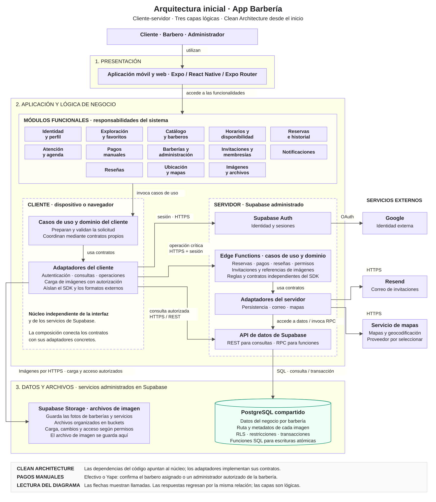
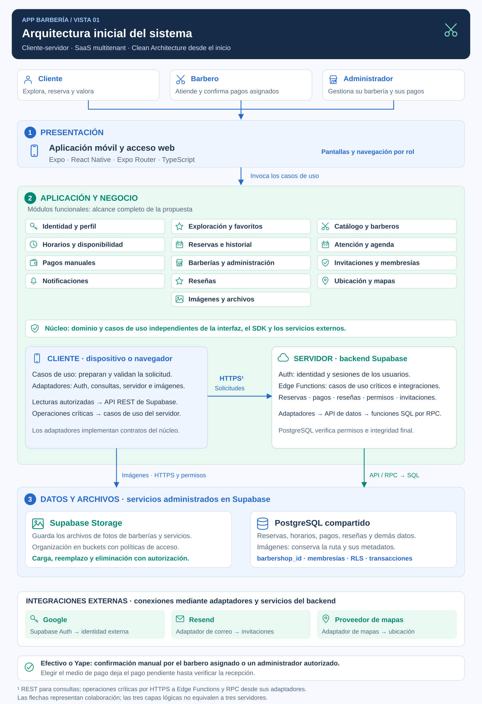

# Arquitectura inicial del sistema

## Propuesta

App Barbería será una plataforma SaaS multitenant: varias barberías utilizarán el mismo sistema con permisos y datos privados delimitados por establecimiento. Adoptará el estilo cliente-servidor, tres capas lógicas —presentación, aplicación y negocio, y datos— y módulos por funcionalidad. Supabase proporcionará el backend administrado; PostgreSQL conservará los datos compartidos con aislamiento por barbería y Supabase Storage almacenará los archivos de imagen.

Clean Architecture será el único enfoque para organizar las dependencias internas desde la primera implementación de cada funcionalidad, tanto en cliente como en servidor. El dominio contendrá tipos y reglas independientes de la tecnología; la aplicación coordinará casos de uso y definirá contratos propios. Presentación e infraestructura dependerán de ese núcleo y la composición conectará los contratos con sus implementaciones. Agrupar por funcionalidades permitirá ordenar las responsabilidades del negocio dentro de esta estructura.

## Diagrama

Ambas vistas representan la misma propuesta y sus 13 módulos: usuarios, presentación, aplicación y negocio, y datos y archivos. El primer diagrama detalla las conexiones entre cliente, servicios del servidor y almacenamiento; la segunda imagen resume esas responsabilidades. Reseñas, mapas e imágenes forman parte del alcance completo.

Las tres capas lógicas agrupan responsabilidades generales; dominio, aplicación, presentación e infraestructura describen la organización interna de Clean Architecture. Las capas no equivalen a tres servidores y los módulos no requieren despliegues independientes. Móvil y web pueden compartir código, pero se representan por separado en C2 porque se ejecutan en entornos distintos. Android es la prioridad; el soporte web se valida por etapas.

## Capas

| Capa | Responsabilidad | Elementos |
|---|---|---|
| Presentación | Recoger entradas y mostrar información y resultados por rol; invocar los casos de uso del cliente. | Pantallas y navegación con Expo, React Native, Expo Router y TypeScript. |
| Aplicación y negocio | En cliente, preparar solicitudes y coordinar resultados. En servidor, autorizar y coordinar operaciones críticas. Mantener reglas y contratos propios independientes de los servicios externos. | Dominio y casos de uso en cliente y servidor; Edge Functions como entorno de ejecución del servidor. Adaptadores para Auth, consultas REST, operaciones HTTPS y persistencia mediante RPC. |
| Datos y archivos | Conservar registros, relaciones e historial; garantizar integridad, permisos y consistencia concurrente; almacenar imágenes con acceso controlado. | PostgreSQL: datos, rutas y metadatos de imágenes, RLS, restricciones y funciones transaccionales. Supabase Storage: archivos de imagen y políticas de acceso. |

Las consultas autorizadas podrán utilizar la API REST de Supabase mediante adaptadores del cliente. Las operaciones críticas se enviarán por HTTPS a los casos de uso del servidor en Edge Functions. Sus adaptadores invocarán, mediante la API de datos y RPC, funciones PostgreSQL para las escrituras atómicas. Las reglas que puedan expresarse sin infraestructura permanecerán en el núcleo; PostgreSQL conservará las comprobaciones definitivas que requieren datos actuales, concurrencia e integridad. El núcleo no importará el SDK de Supabase, React Native ni detalles de Edge Functions o SQL.

## Módulos del negocio

| Módulo | Responsabilidad | Requisitos |
|---|---|---|
| Identidad y perfil | Cuenta, acceso, sesión y datos personales. | RF01-RF05 |
| Exploración y favoritos | Consulta de barberías y preferencias. | RF06-RF08 |
| Catálogo y barberos | Servicios, estilos, profesionales y asignaciones. | RF09, RF10, RF21, RF30-RF32 |
| Horarios y disponibilidad | Jornadas, bloqueos, cierres e intervalos. | RF11, RF12, RF22, RF27, RF33 |
| Reservas e historial | Confirmar, consultar, reprogramar y cancelar citas. | RF13, RF14, RF16-RF19 |
| Atención y agenda | Consultar agenda y registrar atención o inasistencia. | RF20, RF23, RF24, RF36 |
| Pagos manuales | Elegir efectivo o Yape; confirmar recepción por barbero asignado o administrador autorizado; registrar reembolsos por el administrador. | RF15, RF25, RF37, RF38 |
| Barberías y administración | Datos, configuración y publicación. | RF26-RF29 |
| Invitaciones y membresías | Incorporar personal y delimitar permisos por establecimiento. | RF34, RF35, RF41, RF42 |
| Notificaciones | Avisos, lectura y recordatorios internos. | RF39, RF40 |
| Reseñas | Registrar calificación y reseña de una atención propia completada y consultar las publicadas. | RF43 |
| Ubicación y mapas | Registrar ubicaciones, mostrarlas en un mapa y buscar por proximidad con ubicación proporcionada o autorizada por el cliente. | RF44 |
| Imágenes y archivos | Cargar, reemplazar y retirar imágenes de barberías, servicios y estilos con permisos sobre los recursos. | RF26, RF30, RF31 |

Un requisito puede involucrar varios módulos. Por ejemplo, RF30 combina la gestión del catálogo con el almacenamiento de imágenes; el módulo Imágenes y archivos presta esa capacidad a las funcionalidades que la necesitan.

## Confirmación de una reserva

1. El cliente selecciona servicios, un profesional elegible, horario y medio de pago.
2. La pantalla invoca el caso de uso del cliente, que valida la forma de entrada y solicita la confirmación mediante un contrato propio. Su adaptador envía la solicitud por HTTPS con la sesión del usuario.
3. La Edge Function verifica la sesión y entrega el contexto autenticado al caso de uso del servidor. Este coordina la autorización y las reglas del negocio mediante contratos, sin importar el SDK ni formatos de tablas. La identidad se obtiene de la sesión verificada.
4. El adaptador de persistencia invoca por RPC una función PostgreSQL que comprueba permisos, estado, políticas, disponibilidad, duración y precios vigentes antes de escribir. Una transacción guarda reserva, servicios, condiciones históricas, pago pendiente y los avisos internos relacionados.
5. Las comprobaciones y restricciones de intervalos protegen contra reservas activas superpuestas, incluida la separación entre citas, incluso ante solicitudes simultáneas. Si falla una comprobación o escritura, se revierte la transacción.
6. El adaptador transforma la respuesta en un resultado propio del caso de uso y la aplicación muestra confirmación o conflicto. Posteriormente, el barbero asignado o un administrador autorizado de la barbería verifica y confirma manualmente la recepción del pago.

Consultar disponibilidad no garantiza la confirmación posterior. Elegir efectivo o Yape tampoco confirma recepción de dinero.

## Seguridad e integraciones

El acceso a datos privados depende del usuario y del recurso solicitado. Los datos de establecimiento se vinculan a barbershop_id directamente o mediante relaciones verificables. El cliente accede a sus propias reservas; el personal necesita una membresía activa con el rol adecuado en la barbería. RLS (seguridad a nivel de fila) define qué registros puede consultar o modificar cada usuario. Las funciones privilegiadas deben verificar identidad y autorización explícitamente, porque no heredan automáticamente todas las protecciones de RLS. Los perfiles y avisos personales se protegen también por propiedad del usuario.

Para confirmar un pago, el servidor comprobará que el barbero esté asignado a la reserva o que el administrador esté autorizado en esa barbería. Registrará quién confirmó y cuándo, e impedirá confirmaciones duplicadas incluso ante solicitudes simultáneas. Los reembolsos solo los registrará el administrador después de efectuarlos fuera de la plataforma. La selección de Yape o la visualización de sus datos de pago no verifican una transferencia.

Las imágenes se guardarán en Supabase Storage, organizadas en buckets (contenedores de archivos); PostgreSQL conservará sus rutas, metadatos y relación con el recurso del negocio. El cliente cargará y consultará los archivos directamente mediante un adaptador, sujeto a las políticas de Storage. Una Edge Function recibirá las solicitudes para asociar, reemplazar o retirar referencias de imágenes; su caso de uso verificará membresía, rol, recurso y pertenencia del archivo antes de actualizar PostgreSQL. El archivo anterior solo se eliminará de Storage cuando ya no esté referenciado. La carga por sí sola no publica una imagen en el catálogo; el [recorrido de C2](../04-modelo-c4/Nivel2-DiagramadeContenedores.md#recorrido-de-las-imágenes) detalla el proceso y el tratamiento de fallos entre almacenamiento y datos.

La publicación de imágenes o reseñas permitirá su consulta según las reglas de visibilidad, sin conceder permisos de modificación. Para registrar una reseña, el servidor verificará que la atención pertenezca al cliente y esté completada.

Google participará en el acceso mediante Supabase Auth. Resend se utilizará para el correo de invitaciones desde el servidor; los mensajes de acceso se gestionarán mediante Auth y su servicio de correo configurado. La entrega externa se separará de la transacción principal. Los avisos internos que pertenezcan a una transacción conservarán su atomicidad. Las tareas programadas generarán recordatorios internos evitando avisos repetidos para el mismo evento.

La integración de mapas utilizará contratos y adaptadores; su proveedor queda por seleccionar. El cliente podrá proporcionar una ubicación o autorizar el uso de la del dispositivo para buscar por proximidad. Reseñas, mapas y gestión de imágenes se diseñarán como parte del alcance desde el inicio. Los pagos serán manuales; quedan fuera las pasarelas de cobro, la facturación fiscal y el ERP.

El [estilo](estilo-arquitectonico.md), el [enfoque](enfoque-arquitectonico.md) y los [componentes](componentes-arquitectonicos.md) desarrollan esta propuesta. Sus metas se verificarán mediante los [escenarios de calidad](../01-analisis-de-sistema/08-escenarios-atributos-calidad.md).
