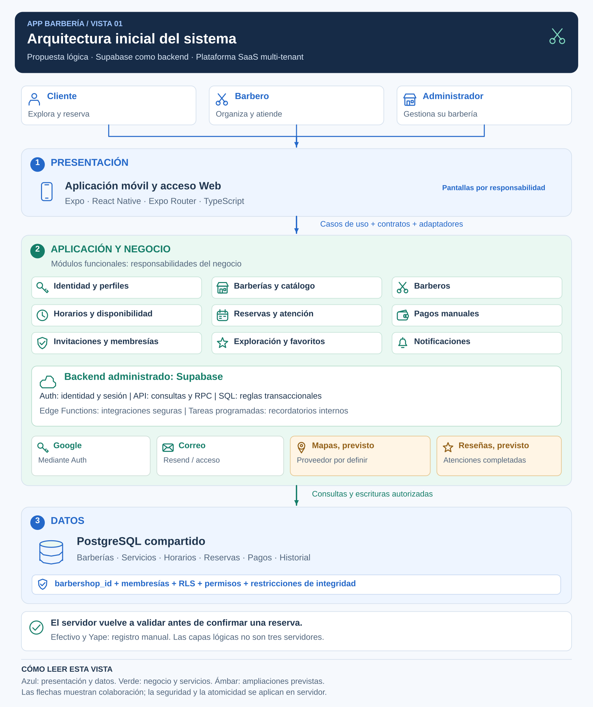

# Arquitectura inicial del sistema

## Propuesta

App Barbería se organizará como una solución cliente-servidor con tres capas lógicas y módulos por funcionalidad. Supabase proporcionará el backend administrado y PostgreSQL compartido conservará los datos de las barberías con acceso contextual.

Se lee de arriba hacia abajo: actores, presentación, aplicación/negocio y datos. Las tarjetas ámbar indican capacidades previstas. Son responsabilidades lógicas, no tres servidores obligatorios.

## Capas

| Capa | Responsabilidad | Elementos |
|---|---|---|
| Presentación | Recoger entradas y mostrar información y resultados por rol. | Expo, React Native y Expo Router. |
| Aplicación y negocio | Coordinar casos de uso y aplicar reglas y permisos definitivos en servidor. | Contratos, adaptadores, Auth, API, funciones PostgreSQL y Edge Functions. |
| Datos | Conservar información, relaciones e historial con integridad y acceso protegido. | PostgreSQL, permisos, RLS, índices y restricciones. |

## Módulos del negocio

| Módulo | Responsabilidad | Requisitos |
|---|---|---|
| Identidad y perfil | Cuenta, acceso, sesión y datos personales. | RF01-RF05 |
| Exploración y favoritos | Consulta de barberías y preferencias. | RF06-RF08 |
| Catálogo y barberos | Servicios, estilos, profesionales y asignaciones. | RF09, RF10, RF21, RF30-RF32 |
| Horarios y disponibilidad | Jornadas, bloqueos, cierres e intervalos. | RF11, RF12, RF22, RF27, RF33 |
| Reservas e historial | Confirmar, consultar, reprogramar y cancelar citas. | RF13, RF14, RF16-RF19 |
| Atención y agenda | Consultar agenda y registrar atención o inasistencia. | RF20, RF23, RF24, RF36 |
| Pagos | Elegir medio y registrar recepción y reembolso manual. | RF15, RF25, RF37, RF38 |
| Barberías y administración | Datos, configuración y publicación. | RF26-RF29 |
| Invitaciones y membresías | Incorporar personal y delimitar permisos por establecimiento. | RF34, RF35, RF41, RF42 |
| Notificaciones | Avisos, lectura y recordatorios internos. | RF39, RF40 |
| Reseñas y ubicación, previsto | Valoraciones y búsqueda por proximidad. | RF43, RF44 |

## Confirmación de una reserva

1. El cliente selecciona servicios, un profesional elegible, horario y medio de pago.
2. El caso de uso envía una solicitud completa mediante un adaptador y la sesión del usuario.
3. PostgreSQL verifica permisos, políticas, disponibilidad, duración y precios del catálogo.
4. Una transacción guarda reserva, servicios, condiciones históricas y datos relacionados de pago y avisos internos.
5. Una restricción de intervalos protege contra reservas activas superpuestas, incluida la separación entre citas. Ante conflicto no quedan escrituras parciales.
6. La aplicación presenta el resultado; el personal autorizado gestiona después el pago y la atención.

Consultar disponibilidad no garantiza la confirmación posterior. Elegir efectivo o Yape tampoco confirma recepción de dinero.

## Seguridad e integraciones

Los datos privados se autorizan por usuario, recurso y membresía activa de la barbería. RLS y permisos protegen tablas; las funciones privilegiadas verifican autorización explícita. La identidad del cliente se deriva de su sesión y no de un identificador editable enviado por la pantalla.

Google participa en el acceso mediante Auth. El correo se utiliza para invitaciones y mensajes de acceso; su entrega externa se separa de la operación principal. Los avisos internos que pertenezcan a una transacción conservan su atomicidad. Las tareas programadas generan recordatorios con deduplicación.

Reseñas, mapas y carga multimedia se incorporarán por etapas. No se incluyen pasarela de cobro, facturación fiscal o ERP.

El [estilo](estilo-arquitectonico.md), el [enfoque](enfoque-arquitectonico.md) y los [componentes](componentes-arquitectonicos.md) desarrollan esta propuesta. Sus metas se verificarán mediante los [escenarios de calidad](../01-analisis-de-sistema/08-escenarios-atributos-calidad.md).
