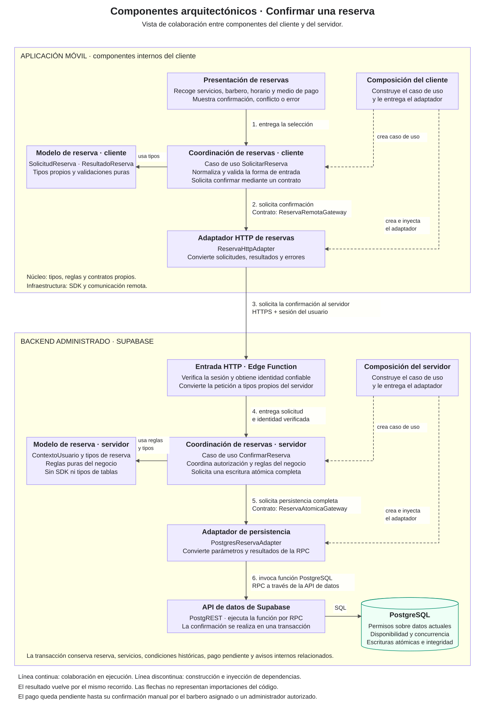
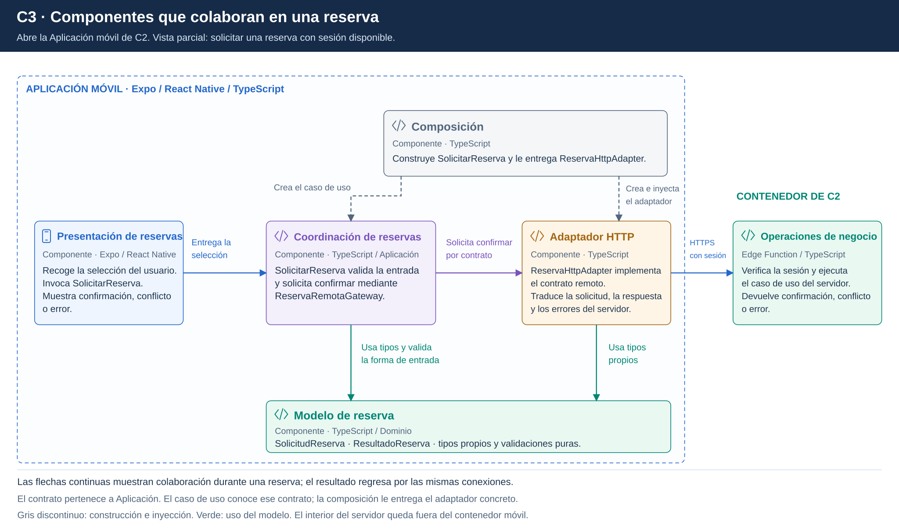

# Componentes arquitectónicos

## Alcance

Los módulos funcionales de la [arquitectura inicial](arquitectura-inicial.md) delimitan capacidades del negocio. Esta vista selecciona la confirmación de una reserva para mostrar cómo colaboran componentes del cliente y del servidor. No enumera todos los componentes del sistema.

**Diagrama**

El primer diagrama muestra el recorrido completo de una reserva, desde la pantalla hasta PostgreSQL. El segundo amplía los componentes internos de la aplicación móvil y se comparte con la vista [C3](../04-modelo-c4/Nivel3-Diagrama-de-Componentes.md). Por ello, su límite es el cliente; los servicios del servidor aparecen fuera de él.

## Responsabilidades

| Componente | Dónde se ejecuta | Responsabilidad |
|---|---|---|
| Pantalla de reservas | Cliente | Recoge servicios, barbero, horario y medio de pago; muestra la confirmación o el conflicto recibido. |
| `SolicitarReserva` | Cliente: aplicación | Prepara la solicitud y pide la confirmación mediante el contrato propio `ReservaRemotaGateway`. |
| Tipos y validaciones de reserva | Cliente: dominio | Representan la solicitud y el resultado; comprueban la forma de entrada sin depender del proveedor. |
| `ReservaHttpAdapter` | Cliente | Implementa el contrato remoto y envía la solicitud con la sesión del usuario por HTTPS a una Edge Function. |
| Entrada HTTP de reservas | Servidor: Edge Function | Verifica la sesión y entrega un contexto de usuario confiable al caso de uso del servidor. |
| `ConfirmarReserva` y reglas propias | Servidor: Edge Function | Coordinan la autorización y la operación completa mediante `ReservaAtomicaGateway`, sin depender de tipos del proveedor. |
| `PostgresReservaAdapter` | Servidor: Edge Function | Implementa el contrato de persistencia e invoca por RPC una función PostgreSQL a través de PostgREST. |
| Función y restricciones de PostgreSQL | Servidor: base de datos | Comprueban el estado vigente, los permisos y la disponibilidad; guardan las escrituras relacionadas en una transacción o las revierten. |
| Composición | Cliente y servidor, por separado | Conecta cada caso de uso con el adaptador que implementa su contrato. |

Los nombres de casos de uso, contratos y adaptadores son ejemplos de diseño de la propuesta; no afirman que ya existan archivos con esos nombres.

## Relaciones y reglas

La pantalla invoca `SolicitarReserva`. Este caso de uso conoce `ReservaRemotaGateway`, no el adaptador HTTP concreto. En el servidor, la entrada HTTP invoca `ConfirmarReserva`, que conoce `ReservaAtomicaGateway`, no el adaptador de PostgreSQL. Cada composición conecta su caso de uso con una implementación. Los SDK, las llamadas remotas y los formatos de tablas quedan en infraestructura; los núcleos de aplicación y dominio no los importan.

Durante la ejecución, el adaptador del cliente llama por HTTPS a la Edge Function; el adaptador del servidor invoca la operación atómica por RPC. La función PostgreSQL vuelve a comprobar permisos, elegibilidad del barbero, disponibilidad, políticas y precios vigentes. Las restricciones impiden reservas superpuestas aun con solicitudes simultáneas. La transacción guarda la reserva, sus condiciones históricas, el pago pendiente y los avisos internos relacionados, o revierte todo ante un conflicto. Consultar disponibilidad previamente solo orienta al usuario.

Esta vista apoya RF09-RF15, RF17 y RF42, además de DA01, DA02, DA04, DA06 y DA11. [C3](../04-modelo-c4/Nivel3-Diagrama-de-Componentes.md) amplía el interior de la aplicación móvil; [C4](../04-modelo-c4/Nivel4-DiagramadeCodigo.md) detalla el código de Coordinación de reservas y presenta la secuencia completa como vista complementaria.
