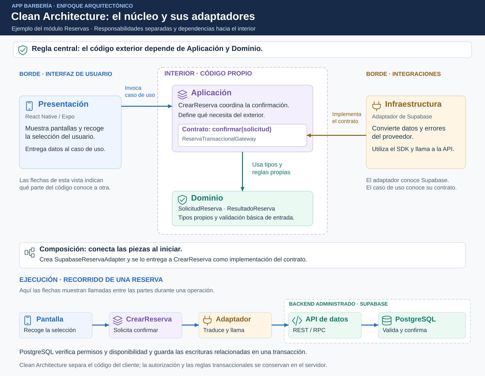

# Enfoque arquitectónico: Clean Architecture

## Objetivo

Separar reglas, coordinación, interfaz y acceso externo. La propuesta organiza cada funcionalidad con responsabilidades claras y dependencias hacia el interior.



## Responsabilidades

| Parte | Qué contiene | Ejemplo para una reserva |
|---|---|---|
| Dominio | Tipos y funciones puras, sin UI ni SDK. | SolicitudReserva, ResultadoReserva y normalización de la entrada. |
| Aplicación | Casos de uso y contratos de las operaciones que necesitan. | CrearReserva y ReservaTransaccionalGateway. |
| Presentación | Pantallas, navegación, entradas y mensajes para el usuario. | Selección de servicios y horario; confirmación o conflicto. |
| Infraestructura | Implementaciones de contratos y conversión de datos externos. | SupabaseReservaAdapter. |
| Composición | Conexión de casos de uso y adaptadores concretos. | Crear el adaptador y entregarlo a CrearReserva. |

## Regla de dependencias

```text
Presentación → Aplicación → Dominio
Infraestructura → Contratos de aplicación
Composición → Caso de uso y adaptador concreto
```

El caso de uso conoce el contrato; no importa el SDK ni decide qué proveedor lo implementa. El adaptador conoce el proveedor y devuelve tipos propios. La composición es el lugar donde se conectan las implementaciones.

## Organización propuesta de una funcionalidad

```text
reservas/
├── dominio/          Tipos y validaciones puras
├── aplicacion/       Caso de uso y contrato transaccional
├── presentacion/     Pantalla y mensajes de resultado
└── infraestructura/  Adaptador Supabase
```

Los módulos pueden usar funciones o clases según la responsabilidad. No se crean capas o interfaces que no aporten una separación útil.

## Flujo de confirmación

La presentación llama a CrearReserva. Este normaliza la entrada y solicita confirmar mediante ReservaTransaccionalGateway. SupabaseReservaAdapter transforma los campos e invoca create_reservation por RPC. El resultado se traduce a confirmación, conflicto o error controlado.

El contrato representa una operación completa: no se hacen llamadas independientes para guardar reserva, servicios y pago desde el cliente.

## Autoridad de las reglas

La validación del cliente ayuda a corregir una selección incompleta. El servidor verifica identidad, membresía, estado, precios y disponibilidad definitiva y conserva la transacción. Las restricciones de PostgreSQL impiden intervalos activos superpuestos.

Parte de las reglas permanece en SQL. Por ello, la organización del código cliente aplica Clean Architecture, pero el backend conserva una dependencia explícita de PostgreSQL. Encapsular una RPC no elimina esa dependencia.

## Verificación

Se revisarán importaciones y se probará el caso de uso con un adaptador de prueba. La autorización y la concurrencia se verificarán además en servidor según EQ-01, EQ-02 y EQ-03. ADR-002 y ADR-010 justifican esta separación.
