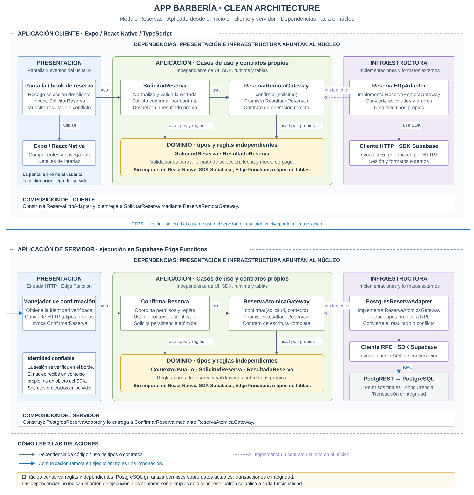
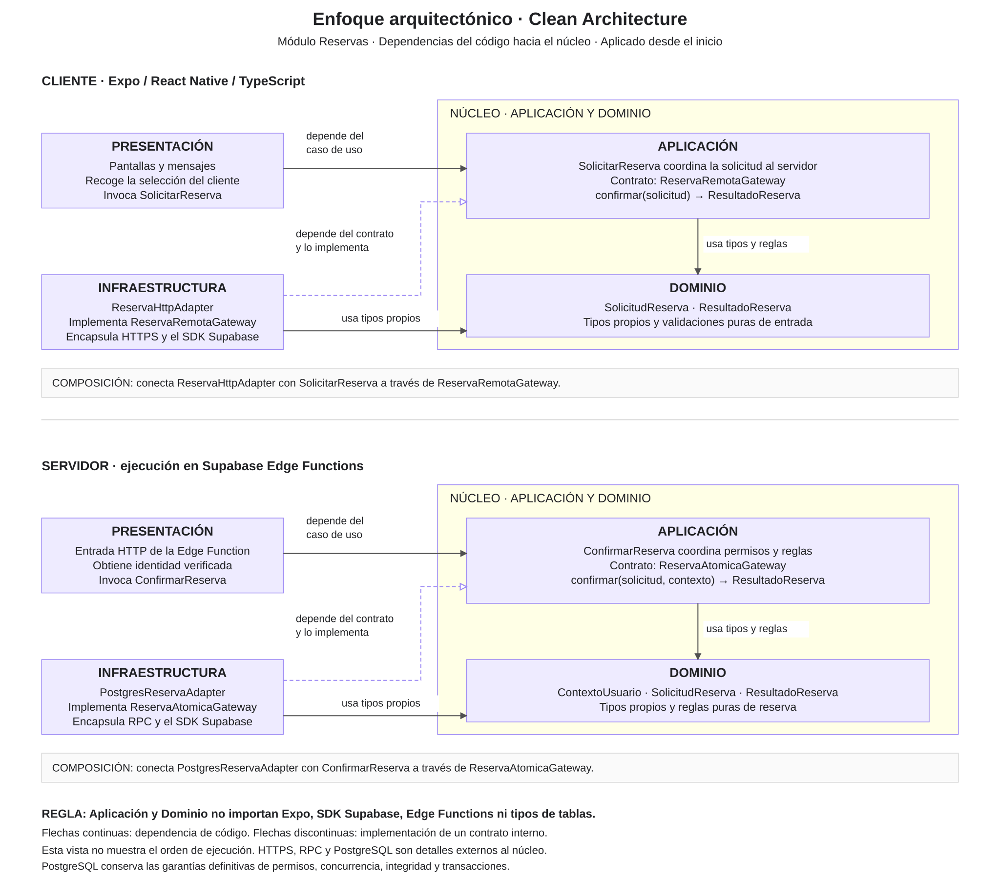
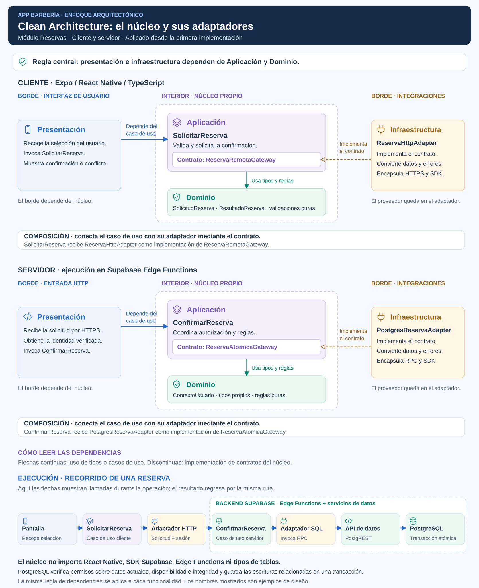

# Enfoque arquitectónico: Clean Architecture

## Objetivo

Aplicar Clean Architecture desde la primera implementación de cada funcionalidad, tanto en el cliente como en los casos de uso del servidor. El dominio y la aplicación forman el núcleo: contienen tipos y reglas propias, coordinan operaciones y definen los contratos que necesitan. Presentación e infraestructura dependen de ese núcleo; la composición conecta los contratos con sus implementaciones. Este enfoque convive con el estilo cliente-servidor y con la organización por módulos funcionales.

## Diagrama







Los tres diagramas usan Reservas como ejemplo del enfoque. El primero detalla las responsabilidades y los contratos separados del cliente y del servidor, y distingue las dependencias del código de la comunicación remota. El segundo resume la regla de dependencias en ambos lados: Presentación usa Aplicación, Infraestructura implementa sus contratos y Aplicación usa tipos y reglas del Dominio. El tercero añade el recorrido de ejecución desde la pantalla hasta PostgreSQL. En cliente y servidor, la composición conecta cada caso de uso con el adaptador que implementa su contrato.

Los nombres de casos de uso y contratos en las imágenes son ejemplos de diseño; expresan responsabilidades previstas y no afirman que esas clases o archivos ya existan.

## Responsabilidades

| Parte | Qué contiene | Ejemplo para una reserva |
|---|---|---|
| Dominio | Tipos y reglas puras que no importan interfaz, SDK, funciones del proveedor ni tipos de tablas. | En cliente: `SolicitudReserva`, `ResultadoReserva` y validaciones de entrada. En servidor: tipos propios, contexto de usuario verificado y reglas puras de reserva. |
| Aplicación | Casos de uso que coordinan operaciones y definen los contratos que necesitan. | En cliente: `SolicitarReserva` usa `ReservaRemotaGateway` para solicitar la confirmación. En servidor: `ConfirmarReserva` usa `ReservaAtomicaGateway` para persistirla como operación completa. |
| Presentación | Recibe entradas, invoca casos de uso y entrega resultados. | En cliente: pantalla de selección y mensajes de resultado. En servidor: entrada HTTP de la Edge Function que verifica la sesión y entrega un contexto propio al caso de uso. |
| Infraestructura | Implementa contratos y traduce datos, resultados y errores de servicios externos. | En cliente: `ReservaHttpAdapter` invoca la Edge Function por HTTPS. En servidor: `PostgresReservaAdapter` invoca una función PostgreSQL mediante RPC. |
| Composición | Construye los adaptadores y los entrega a los casos de uso correspondientes. | Conectar `ReservaHttpAdapter` con `SolicitarReserva` y `PostgresReservaAdapter` con `ConfirmarReserva`, cada uno mediante su contrato. |

## Regla de dependencias

```text
Presentación del cliente o servidor → Aplicación → Dominio
Infraestructura del cliente o servidor → Contratos de Aplicación y tipos del Dominio
Composición de cada lado → Caso de uso y adaptador concreto
```

Cada caso de uso conoce su contrato, pero no importa el SDK ni conoce al adaptador concreto. El adaptador implementa ese contrato, conoce el servicio externo y devuelve tipos propios. Las flechas de los diagramas de dependencias muestran qué código conoce a otro; el orden de llamadas durante una reserva se explica aparte en el flujo de confirmación.

## Organización propuesta de una funcionalidad

```text
cliente/reservas/
├── dominio/          Tipos y validaciones puras de entrada
├── aplicacion/       SolicitarReserva y ReservaRemotaGateway
├── presentacion/     Pantalla y mensajes de resultado
└── infraestructura/  ReservaHttpAdapter

servidor/reservas/
├── dominio/          Tipos propios y reglas puras de reserva
├── aplicacion/       ConfirmarReserva y ReservaAtomicaGateway
├── presentacion/     Entrada HTTP y contexto autenticado
└── infraestructura/  PostgresReservaAdapter
```

Los dos bloques representan responsabilidades, no una estructura de carpetas obligatoria. Cada lado tiene un punto de composición que conecta sus contratos y adaptadores. Los módulos pueden usar funciones o clases según la responsabilidad; no se crean interfaces sin una operación concreta que separar.

## Flujo de confirmación

1. La pantalla recoge servicios, barbero, horario y medio de pago e invoca `SolicitarReserva`. Este caso de uso valida la forma de entrada y solicita la confirmación mediante `ReservaRemotaGateway`.
2. `ReservaHttpAdapter` implementa ese contrato y envía la solicitud con la sesión del usuario por HTTPS a una Edge Function. La función verifica la sesión y convierte la entrada en tipos propios para el caso de uso del servidor.
3. `ConfirmarReserva` coordina autorización y reglas de negocio. Mediante `ReservaAtomicaGateway` solicita una confirmación completa a `PostgresReservaAdapter`, que invoca por RPC la función PostgreSQL correspondiente a través de la API de datos.
4. PostgreSQL comprueba de nuevo permisos, políticas, precios y disponibilidad actuales. Sus restricciones protegen los intervalos ante solicitudes simultáneas; una transacción guarda la reserva, sus condiciones históricas, el pago pendiente y los avisos internos relacionados, o revierte todas las escrituras ante un conflicto.
5. El resultado vuelve por los adaptadores como confirmación, conflicto o error controlado. El cliente muestra el resultado recibido del servidor.

El contrato remoto del cliente representa una solicitud completa al servidor. El contrato de persistencia del servidor representa una escritura atómica completa. La aplicación cliente no divide la confirmación en llamadas independientes para guardar reserva, servicios y pago.

## Autoridad de las reglas

La validación del cliente ayuda a corregir una selección incompleta. El caso de uso del servidor recibe identidad verificada y coordina reglas y permisos sin depender de tipos del proveedor. PostgreSQL conserva las comprobaciones definitivas que necesitan datos actuales: pertenencia a la barbería, asignación y rol cuando correspondan, estado, precios, disponibilidad y concurrencia. Las escrituras relacionadas se realizan en una sola transacción y las restricciones impiden intervalos activos superpuestos.

Las reglas que pueden expresarse sin infraestructura se mantienen en el núcleo del cliente o del servidor, según su responsabilidad. Las garantías transaccionales y las comprobaciones que requieren el estado vigente permanecen en PostgreSQL. El adaptador encapsula esa dependencia tecnológica; SQL se prueba por integración y no se presenta como código independiente de la base de datos. Elegir efectivo o Yape deja el pago pendiente hasta que el barbero asignado o un administrador autorizado confirme manualmente su recepción.

## Verificación

Se revisarán las importaciones y se probarán por separado `SolicitarReserva` y `ConfirmarReserva` con adaptadores de prueba, sin interfaz, SDK ni base de datos. Las pruebas de integración verificarán los adaptadores, la autorización contextual, la transacción y la concurrencia en PostgreSQL según EQ-01, EQ-02 y EQ-03. ADR-002 y ADR-010 justifican esta separación.
