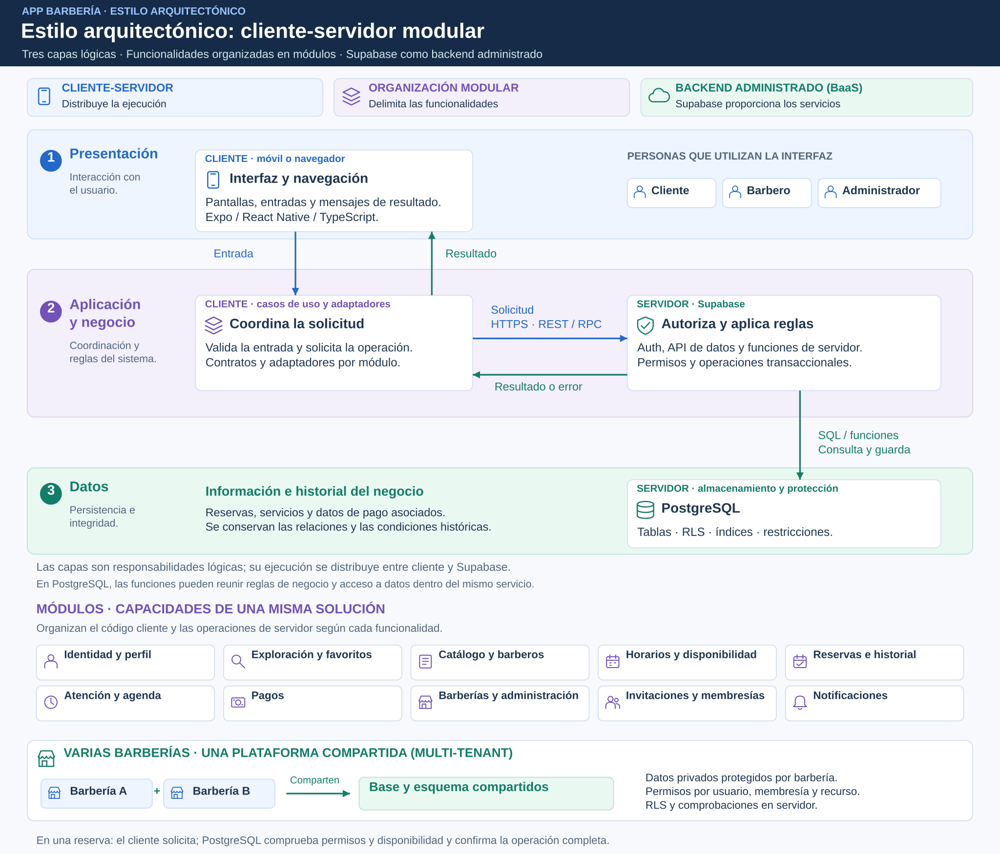

# Estilo arquitectónico

## Estilo seleccionado

**Cliente-servidor con tres capas lógicas, organización modular por funcionalidades y Supabase como backend administrado (BaaS).**

Las tres franjas muestran presentación, aplicación/negocio y datos. En la segunda capa, el cliente coordina la solicitud y el servidor aplica permisos y reglas definitivas; las flechas distinguen solicitud y respuesta. Debajo se muestran los módulos del negocio y cómo varias barberías comparten la plataforma con protección de su información privada.

## Qué significa

| Dimensión | Aplicación en Barbería |
|---|---|
| Cliente-servidor | La aplicación solicita operaciones a los servicios de servidor mediante HTTPS. |
| Capas lógicas | Se distinguen presentación, aplicación/negocio y datos. No representan tres servidores obligatorios. |
| Modularidad | Identidad, barberías, catálogo, horarios, reservas, pagos y comunicación tienen responsabilidades delimitadas. |
| Backend administrado | Supabase aporta Auth, API, PostgreSQL y funciones de servidor; el proyecto define sus reglas y permisos. |
| Multi-tenant | Varias barberías comparten base y esquema con aislamiento por membresía, usuario y recurso. |

## Límites de ejecución

La aplicación cliente, en el dispositivo o navegador, ejecuta la interfaz y coordina las solicitudes. Auth gestiona identidad; la API expone consultas y RPC; PostgreSQL aplica reglas definitivas y transacciones. Las Edge Functions integran servicios como correo cuando se necesita ejecución segura de servidor.

Las funciones SQL pueden combinar negocio y acceso a datos dentro del mismo servicio. Las capas lógicas y los contenedores C4 describen aspectos distintos del sistema.

## Justificación y alternativas

| Alternativa | Evaluación |
|---|---|
| Supabase y módulos funcionales | Seleccionada: concentra el esfuerzo en el negocio y delega parte de la administración de infraestructura. |
| API propia como monolito modular | Añade servidor y despliegue propios; requiere una necesidad que justifique ese trabajo. |
| Microservicios de negocio | Agregan coordinación y operación independientes que el alcance inicial no necesita. |

No se documenta una API Node.js como parte del diseño. Los módulos de Barbería tampoco son microservicios por utilizar servicios de Supabase.

## Crecimiento

Se medirán tiempos, errores y recursos y se optimizarán consultas e índices antes de ampliar capacidad. Las metas se desarrollan en EQ-04, EQ-05 y EQ-06. Una mayor cantidad de usuarios no obliga por sí sola a cambiar el estilo.

ADR-001 define la organización global; ADR-003 la comunicación; ADR-004 y ADR-005 el aislamiento y acceso; ADR-006 las transacciones; ADR-011 el crecimiento.
