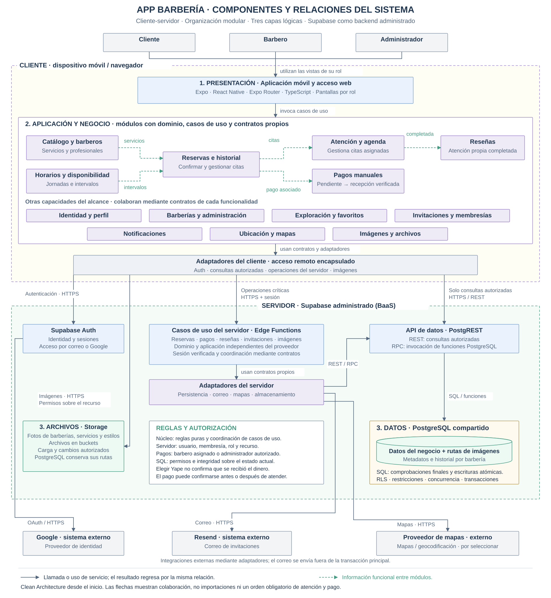
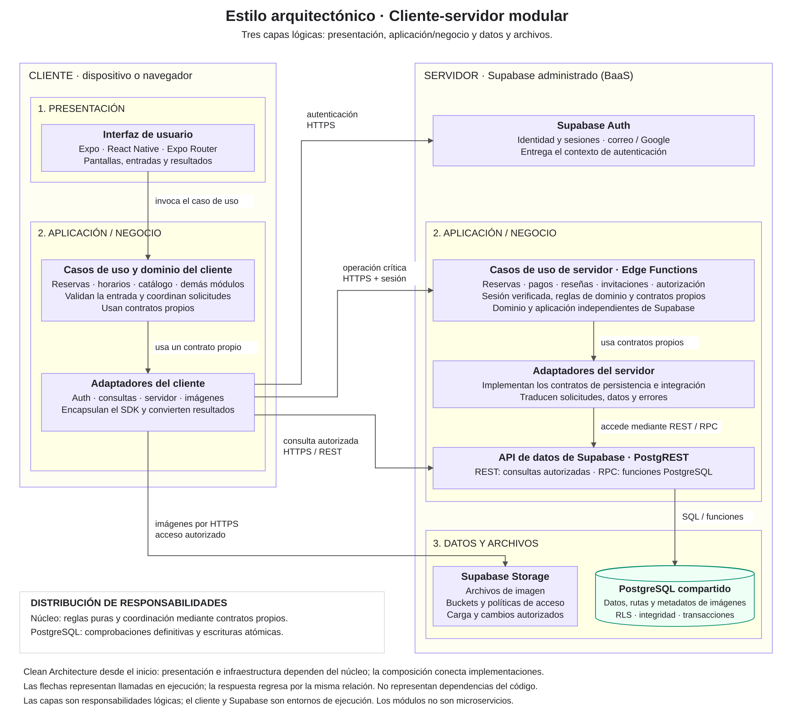
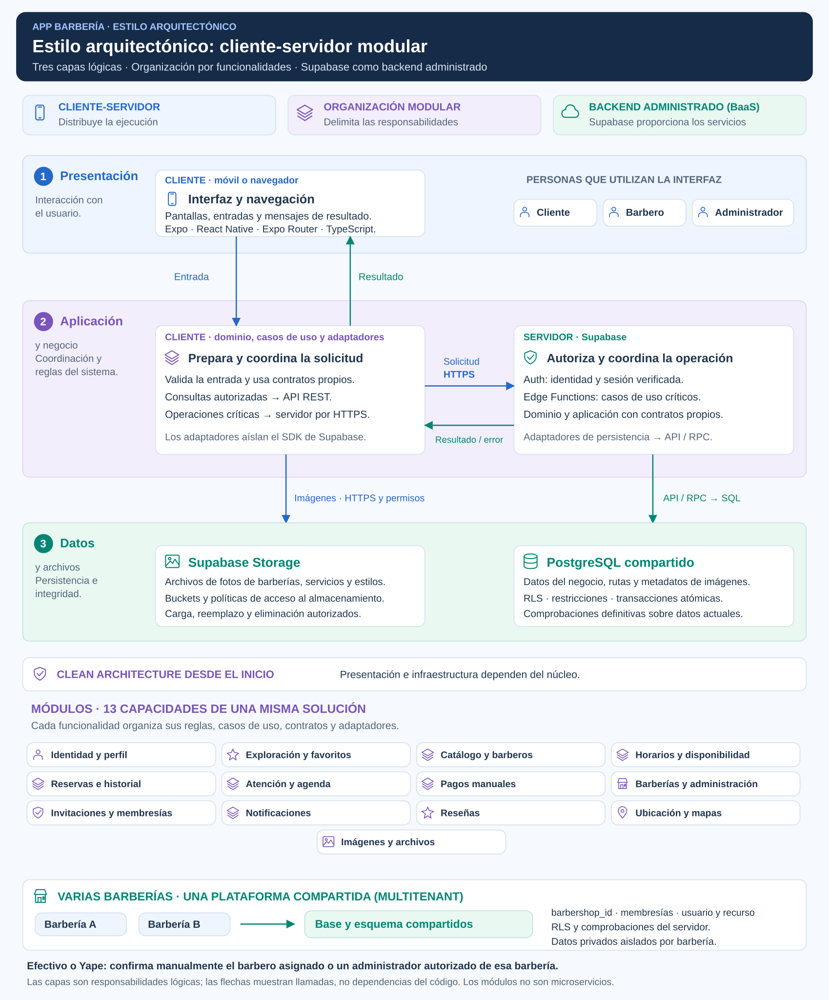

# Estilo arquitectónico

## Estilo seleccionado

**Cliente-servidor con tres capas lógicas, organización modular por funcionalidades y Supabase como backend administrado (BaaS).**

Cliente-servidor define cómo colaboran la aplicación cliente y los servicios del backend. Las tres capas lógicas agrupan presentación, aplicación y negocio, y datos y archivos; no representan tres servidores. Los módulos delimitan funcionalidades dentro de la misma solución. Clean Architecture organiza desde el inicio las dependencias internas de cada funcionalidad, tanto en cliente como en servidor: las reglas y casos de uso no dependen directamente de pantallas, SDK ni servicios externos.

**Diagrama**

El primer diagrama muestra las relaciones funcionales clave de una cita y las demás capacidades del alcance: 13 módulos en total. Sus flechas verdes discontinuas indican información que una funcionalidad aporta a otra; no imponen un orden único para atender y confirmar un pago. Las flechas continuas muestran llamadas o uso de servicios, con respuesta por la misma relación. El segundo diagrama distingue las capas lógicas y los entornos de ejecución. El tercero resume estas responsabilidades, los 13 módulos y el aislamiento entre barberías.

## Qué significa

| Dimensión | Aplicación en Barbería |
|---|---|
| Cliente-servidor | La aplicación móvil o web utiliza servicios de Supabase mediante HTTPS. Consulta datos autorizados por REST y envía operaciones críticas a casos de uso del servidor en Edge Functions. |
| Capas lógicas | Presentación, aplicación y negocio, y datos y archivos agrupan responsabilidades. No representan tres servidores ni sustituyen las responsabilidades internas de Clean Architecture. |
| Modularidad | Trece funcionalidades delimitan identidad, exploración, catálogo, horarios, reservas, atención, pagos manuales, barberías, invitaciones, notificaciones, reseñas, ubicación e imágenes. Son partes de la misma solución, no microservicios. |
| Backend administrado | Supabase proporciona Auth, Edge Functions, API de datos, PostgreSQL y Storage. El proyecto define casos de uso, permisos y reglas de negocio. |
| Plataforma multitenant | Varias barberías comparten base y esquema. Los datos privados se aíslan según barbería, membresía, usuario y recurso mediante RLS y comprobaciones de servidor. |

## Límites de ejecución

La aplicación cliente, en el dispositivo o navegador, ejecuta la interfaz y los casos de uso que preparan solicitudes y resultados. Sus adaptadores utilizan Supabase Auth para identidad, la API REST para consultas autorizadas y Edge Functions por HTTPS para operaciones críticas. La validación del cliente ayuda al usuario; no confirma por sí sola permisos, disponibilidad ni recepción de pagos.

Las Edge Functions alojan casos de uso de servidor para reservas, pagos, reseñas, invitaciones y gestión de las referencias de imágenes. La entrada HTTP verifica la sesión y los casos de uso coordinan las reglas mediante contratos propios. Sus adaptadores invocan por RPC las funciones PostgreSQL necesarias para escrituras atómicas e integran, cuando corresponda, correo y mapas. PostgreSQL conserva datos, rutas y metadatos de imágenes; realiza comprobaciones definitivas sobre el estado actual, aplica RLS, restricciones y transacciones.

El cliente transfiere los archivos directamente a Supabase Storage mediante un adaptador y con políticas de acceso por usuario, barbería y recurso. Para asociar, reemplazar o retirar la imagen de una barbería, servicio o estilo, solicita la operación a la Edge Function: el caso de uso comprueba membresía, rol, recurso y pertenencia del archivo antes de actualizar la referencia en PostgreSQL. La carga del archivo y su publicación en el negocio son operaciones diferentes. El [recorrido de imágenes de C2](../04-modelo-c4/Nivel2-DiagramadeContenedores.md#recorrido-de-las-imágenes) desarrolla ambas responsabilidades y la recuperación ante fallos.

Las reglas que pueden expresarse sin infraestructura permanecen en el dominio y los casos de uso. SQL conserva las garantías que requieren datos actuales o concurrencia. La composición conecta contratos y adaptadores, de modo que el núcleo no importa React Native ni detalles de Supabase. Las capas lógicas y los contenedores C4 describen aspectos distintos del sistema.

## Justificación y alternativas de backend

La elección de backend se evalúa dentro del estilo cliente-servidor seleccionado. Clean Architecture sigue siendo el enfoque para las dependencias internas de cualquiera de las funcionalidades; no es una alternativa de backend.

| Opción de backend | Evaluación |
|---|---|
| Supabase con funcionalidades organizadas en módulos | Seleccionada: aporta servicios administrados y permite concentrar el trabajo en casos de uso, permisos y reglas. Las operaciones críticas se ejecutan en Edge Functions y se completan con garantías transaccionales en PostgreSQL. |
| API propia como monolito modular | Exigiría desplegar y mantener un servidor propio. No se identifica una necesidad que justifique añadirlo a esta propuesta. |
| Backend dividido en microservicios de negocio | Requeriría despliegues, comunicación y coordinación independientes entre servicios. El alcance no presenta una necesidad concreta para esa complejidad. |

La propuesta no incorpora una API propia Node.js. El uso de varios servicios administrados de Supabase no convierte los módulos funcionales en microservicios.

## Crecimiento

Se medirán tiempos, errores y recursos y se optimizarán consultas e índices antes de ampliar capacidad. Las metas se desarrollan en EQ-04, EQ-05 y EQ-06. Una mayor cantidad de usuarios no obliga por sí sola a cambiar el estilo.

ADR-001 define la organización global; ADR-003 la comunicación; ADR-004 y ADR-005 el aislamiento y acceso; ADR-006 las transacciones; ADR-011 el crecimiento.
