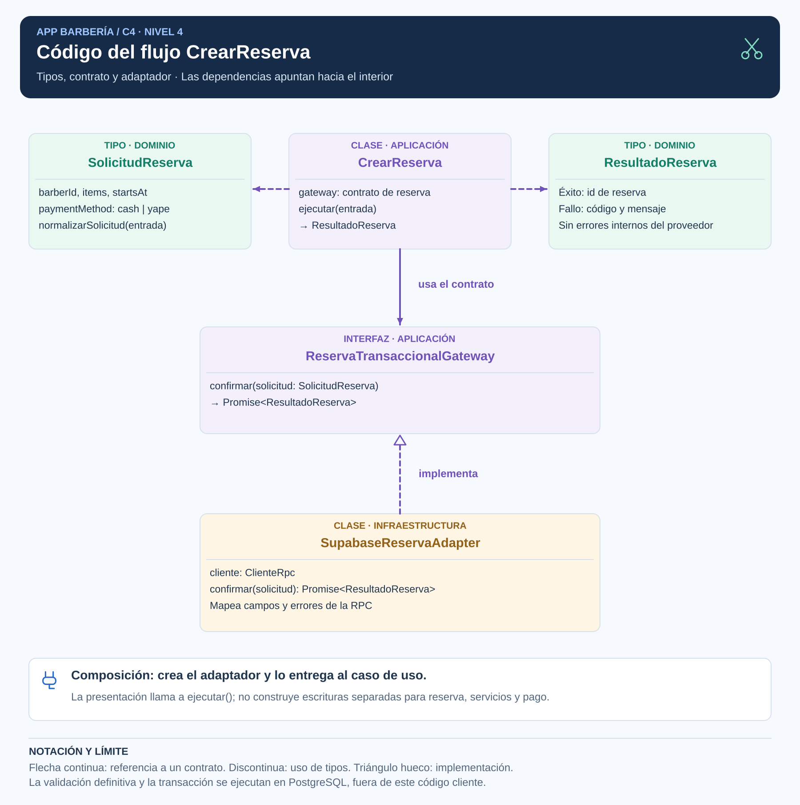
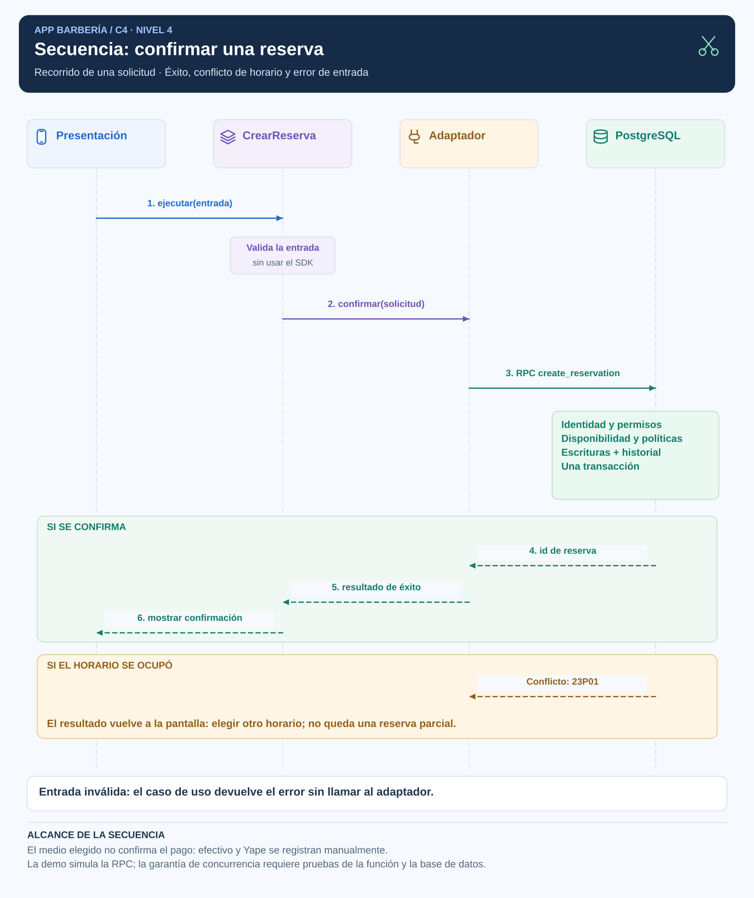

# Diseño interno de módulos

## Módulo seleccionado: Reservas

El flujo CrearReserva concentra una operación importante: validar la selección y pedir una confirmación atómica al servidor. Este diseño responde a RF09-RF15, RF17 y RF42 y a ADR-002, ADR-005 y ADR-006.

## Organización

```text
reservas/
├── dominio/          SolicitudReserva, ResultadoReserva y validación de entrada
├── aplicacion/       CrearReserva y ReservaTransaccionalGateway
├── infraestructura/  SupabaseReservaAdapter
└── presentacion/     Entrada y presentación del resultado
composicion           Conecta caso de uso y adaptador
```

En la demostración técnica, src contiene solamente este flujo. En la aplicación, estas responsabilidades se agruparán dentro de la funcionalidad de reservas.

## Tipos, clases e interfaces



| Elemento | Responsabilidad | Depende de |
|---|---|---|
| SolicitudReserva | Datos seleccionados: barbero, servicios, horario y medio de pago. | Tipos propios. |
| normalizarSolicitud | Verificar forma de entrada, servicios no repetidos, horario con zona y medio permitido. | Dominio. |
| ResultadoReserva | Expresar éxito con id o fallo con código y mensaje. | Tipos propios. |
| CrearReserva | Validar entrada y coordinar la confirmación. | Dominio y contrato. |
| ReservaTransaccionalGateway | Definir una operación completa de confirmación. | Solicitud y resultado. |
| SupabaseReservaAdapter | Transformar campos, llamar a RPC y traducir errores. | Contrato y cliente RPC. |
| Composición | Crear las implementaciones y conectarlas. | Caso de uso y adaptador. |

El SDK no se importa desde dominio o aplicación. La función de composición puede conocer ambas partes para conectarlas.

## Contrato y reglas

| Entrada o regla | Decisión |
|---|---|
| Profesional | La solicitud lleva un barbero concreto, aunque previamente se haya elegido cualquiera elegible. |
| Servicios | Uno o varios identificadores; estilo opcional por servicio. |
| Horario | Instante con zona horaria; presentación en America/Lima. |
| Medio de pago | cash o yape; no equivale a pago recibido. |
| Identidad y barbería | El servidor las deriva y verifica mediante sesión y relaciones autorizadas. |
| Precios y políticas | Se leen y validan en servidor y se conservan las condiciones de la reserva. |
| Concurrencia | Revalidación y restricción de intervalos en una transacción. |

La RPC create_reservation recibe p_barber_id, p_items, p_starts_at y p_payment_method. Devuelve el UUID de la reserva. p_items contiene service_id y style_id; el cliente no decide el precio.

## Secuencia y errores



| Resultado | Comportamiento |
|---|---|
| Entrada inválida | La aplicación informa qué corregir y no llama al proveedor. |
| Confirmación | Muestra el identificador de reserva; el pago permanece sujeto a confirmación manual. |
| Horario ocupado | El servidor rechaza la operación y la pantalla permite elegir otro intervalo. |
| Sin autorización | Rechaza la operación sin exponer datos privados. |
| Respuesta perdida | Se consulta la agenda antes de reenviar; no hay reintento automático de escritura. |

Las pruebas de la demostración comprueban coordinación y mapeo. Las garantías de permisos y atomicidad requieren los escenarios de servidor EQ-01, EQ-02 y EQ-03.
