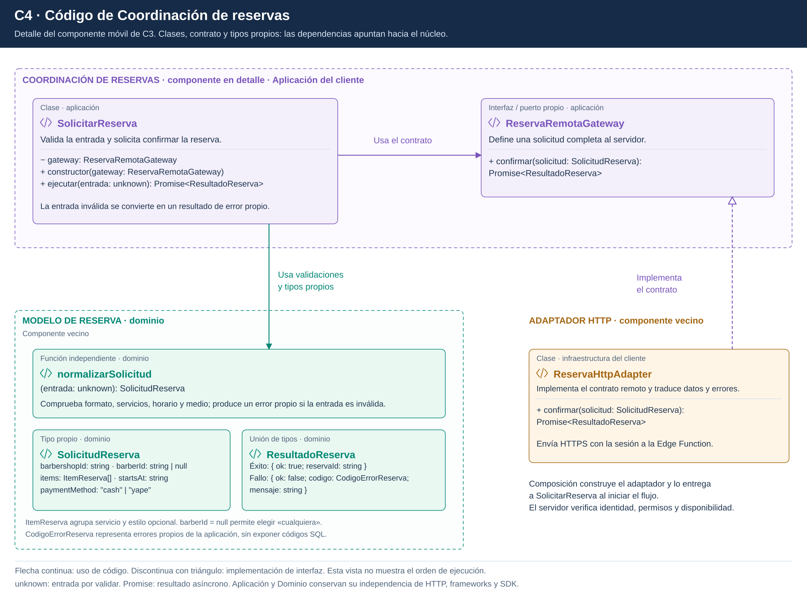
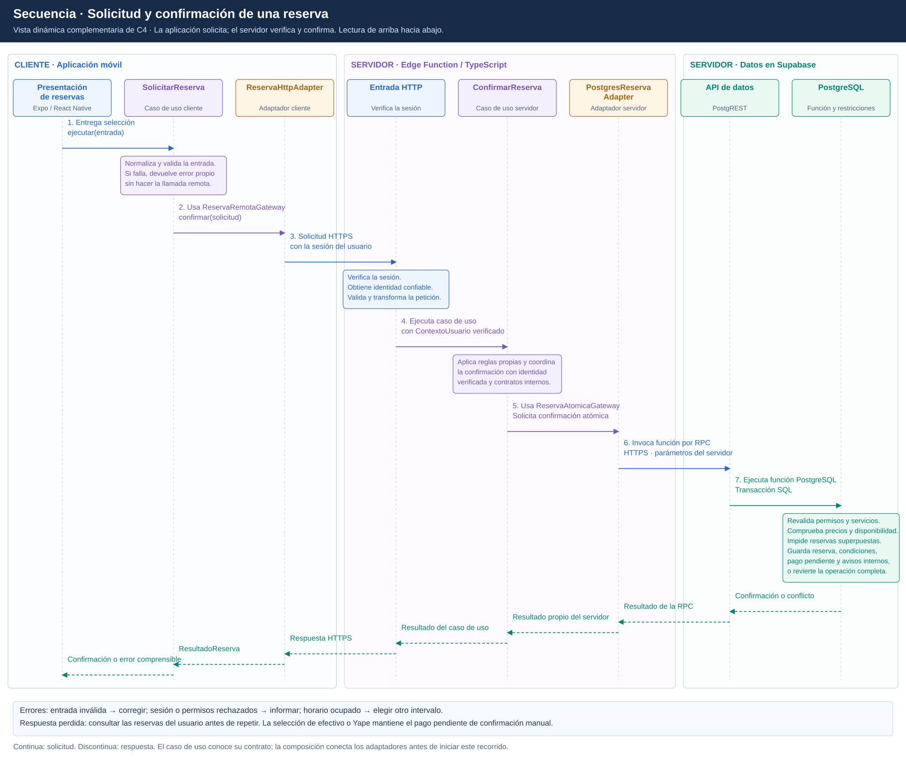

# Diseño interno de módulos

## Módulo seleccionado: Reservas

El módulo Reservas permite seleccionar servicios, barbero y horario, y confirmar la cita sin aceptar intervalos incompatibles. El cliente prepara la solicitud; el servidor verifica la identidad, coordina la operación y pide una escritura atómica. Este diseño responde a RF09-RF15, RF17 y RF42, y a ADR-002, ADR-005 y ADR-006.

## Organización

```text
cliente/reservas/
├── dominio/          SolicitudReserva, ResultadoReserva y validaciones puras
├── aplicacion/       SolicitarReserva y ReservaRemotaGateway
├── presentacion/     Pantalla de selección y mensajes de resultado
└── infraestructura/  ReservaHttpAdapter: llamada HTTPS al servidor

servidor/reservas/
├── dominio/          Tipos propios y reglas puras de reserva
├── aplicacion/       ConfirmarReserva y ReservaAtomicaGateway
├── presentacion/     Entrada HTTP y contexto de usuario verificado
└── infraestructura/  PostgresReservaAdapter: RPC hacia PostgreSQL
```

Esta distribución expresa responsabilidades, no rutas obligatorias del repositorio. Cliente y servidor tienen cada uno un punto de composición que conecta su caso de uso con el adaptador concreto mediante un contrato propio. Las demás funcionalidades seguirán la misma regla de dependencias desde su primera implementación.

## Tipos, clases e interfaces



La imagen detalla el código de Coordinación de reservas del cliente y sus componentes vecinos. La tabla siguiente incluye también las responsabilidades del servidor que completan el flujo.

| Elemento | Lado | Responsabilidad y dependencia principal |
|---|---|---|
| `SolicitudReserva` y validaciones puras | Cliente | Representan barbería, barbero específico o «cualquiera», servicios, horario y medio de pago; comprueban la forma de entrada sin consultar servicios externos. |
| `ResultadoReserva` | Cliente | Expresa confirmación, conflicto o error controlado con significado propio de la aplicación. |
| `SolicitarReserva` | Cliente | Prepara la solicitud y pide su confirmación mediante `ReservaRemotaGateway`; depende de tipos propios y de ese contrato. |
| `ReservaRemotaGateway` | Cliente | Define una única solicitud completa al servidor y su resultado; no expone operaciones de tablas. |
| `ReservaHttpAdapter` | Cliente | Implementa el contrato remoto, envía la sesión por HTTPS a la Edge Function y traduce su respuesta o error. |
| Entrada HTTP de reservas | Servidor | Verifica la sesión, transforma la petición y entrega un contexto de usuario confiable a `ConfirmarReserva`. |
| `ConfirmarReserva` y reglas puras | Servidor | Coordinan la confirmación con identidad verificada y reglas propias; dependen de `ReservaAtomicaGateway`, no de PostgreSQL. |
| `ReservaAtomicaGateway` | Servidor | Define la confirmación y persistencia como una operación completa. |
| `PostgresReservaAdapter` | Servidor | Implementa el contrato atómico e invoca una función PostgreSQL mediante PostgREST RPC; convierte datos y errores externos. |
| Composición | Ambos lados | Construye y conecta el adaptador y el caso de uso correspondientes. |

Estos nombres son ejemplos de diseño, no una afirmación sobre archivos implementados. El núcleo del cliente no importa React Native, el SDK ni detalles HTTP; el núcleo del servidor no importa detalles de Edge Functions, RPC o SQL. Los adaptadores sí conocen esas tecnologías, y la composición puede conocer ambas piezas para conectarlas.

## Contrato y reglas

| Entrada o regla | Decisión |
|---|---|
| Profesional | `barberId = null` representa «cualquiera». El servidor determina un barbero que realice todos los servicios seleccionados y comprueba su elegibilidad y disponibilidad vigentes en la operación atómica. |
| Servicios | Uno o varios identificadores; estilo opcional por servicio. |
| Horario | La solicitud indica un instante inequívoco; la interfaz lo muestra según la zona horaria del establecimiento. |
| Medio de pago | Efectivo o Yape; la reserva conserva el pago pendiente hasta que confirme su recepción el barbero asignado o un administrador autorizado de esa barbería. |
| Identidad y barbería | La Edge Function verifica la sesión; el servidor comprueba la relación autorizada con la barbería y el recurso, sin confiar en un identificador de usuario enviado por la pantalla. |
| Precios y políticas | El servidor obtiene y verifica las condiciones vigentes; la reserva conserva los valores históricos relevantes. |
| Concurrencia | PostgreSQL revalida disponibilidad y permisos actuales, aplica restricciones de intervalos y guarda las escrituras relacionadas en una transacción. |

El contrato remoto del cliente expresa la solicitud de reserva, no los parámetros de una tabla o función SQL. La firma de la función PostgreSQL pertenece a la infraestructura del servidor y se concretará al implementarla; no forma parte del contrato del cliente. El cliente no fija precios ni interpreta que una selección de Yape confirme la recepción del pago.

## Secuencia y errores

La secuencia prevista es: pantalla → `SolicitarReserva` → `ReservaHttpAdapter` → entrada HTTP de la Edge Function → `ConfirmarReserva` → `PostgresReservaAdapter` → PostgREST RPC → PostgreSQL. El resultado vuelve por el mismo recorrido. Las imágenes de esta sección se comparten con la vista de código y su secuencia complementaria en el modelo C4.



| Resultado | Comportamiento |
|---|---|
| Entrada inválida | La pantalla informa qué corregir sin enviar una solicitud remota innecesaria; el servidor también valida lo recibido. |
| Confirmación | Muestra el identificador de reserva; el pago permanece sujeto a confirmación manual. |
| Horario ocupado | El servidor rechaza la operación y la pantalla permite elegir otro intervalo. |
| Sin autorización | Rechaza la operación sin exponer datos privados. |
| Respuesta perdida | Se consulta el estado de las reservas del usuario antes de repetir la solicitud; no se reintenta automáticamente una escritura de resultado desconocido. |

Las pruebas unitarias verificarán por separado los casos de uso del cliente y del servidor con adaptadores de prueba. Las pruebas de integración comprobarán sesión, autorización, traducción de datos, transacción y concurrencia según EQ-01, EQ-02 y EQ-03.
