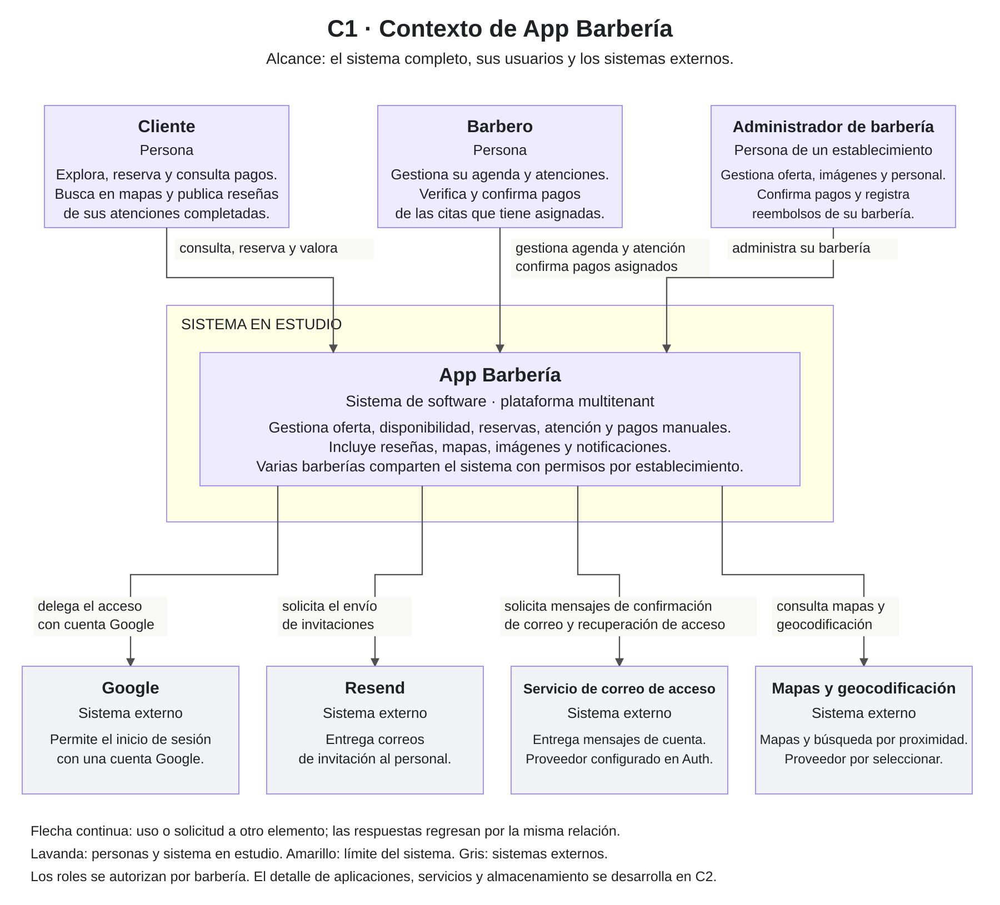
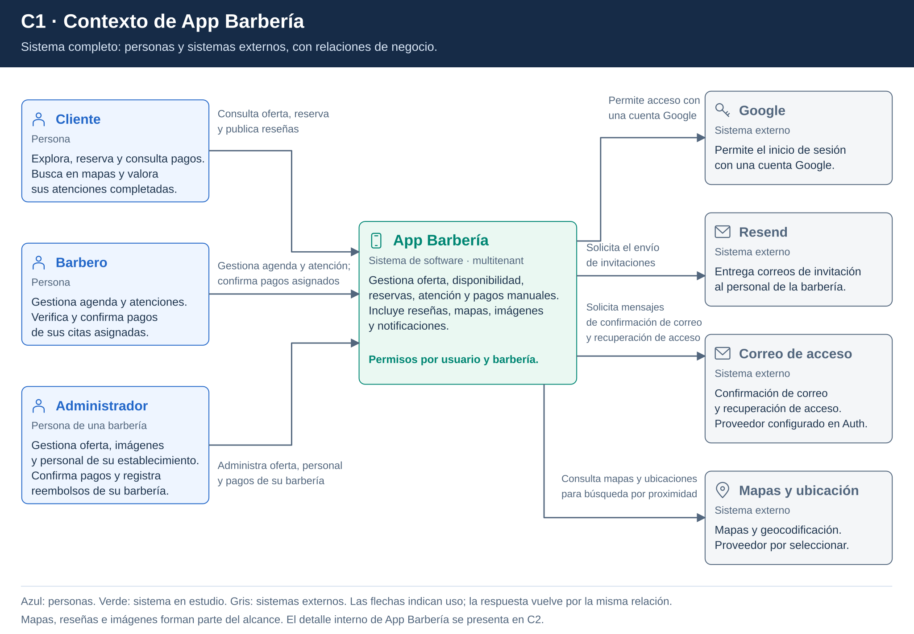

# C1. Contexto del sistema

## Alcance

Representa App Barbería como un único sistema de software y muestra quién lo utiliza y con qué sistemas externos se relaciona. La propuesta incluye reservas, atención, pagos manuales, reseñas, mapas, imágenes y notificaciones. C2 detalla las aplicaciones, los servicios y los almacenes que forman el sistema.

## Diagrama

Las dos imágenes representan el mismo alcance con distribuciones y colores diferentes. Cada una incluye su propia leyenda. El proveedor de mapas todavía se debe seleccionar, pero la funcionalidad de mapas y búsqueda por proximidad forma parte del alcance.

## Elementos y relaciones

| Elemento | Tipo | Relación con App Barbería |
|---|---|---|
| Cliente | Persona | Explora barberías, consulta mapas y reseñas, gestiona reservas, consulta sus pagos y valora atenciones propias completadas; HU01-HU12, HU28 y HU29. |
| Barbero | Persona | Gestiona su agenda y atenciones; verifica y confirma manualmente pagos de las citas que tiene asignadas; HU13-HU16. |
| Administrador de barbería | Persona de un establecimiento | Gestiona oferta, imágenes y personal; confirma pagos y registra reembolsos autorizados de su barbería; HU17-HU22, HU24 y HU25. |
| App Barbería | Sistema en estudio | Organiza oferta, disponibilidad, reservas, atención, pagos manuales, reseñas, mapas, imágenes y notificaciones para varias barberías. |
| Google | Sistema externo | Permite el acceso con una cuenta Google; RF02. |
| Resend | Sistema externo | Entrega correos de invitación al personal; RF34. |
| Servicio de correo de acceso | Sistema externo | Entrega mensajes de confirmación de correo y recuperación de acceso mediante el proveedor configurado en Auth; RF01 y RF04. |
| Servicio de mapas y geocodificación | Sistema externo | Proporciona mapas y datos de ubicación para la búsqueda por proximidad; RF44. Proveedor por seleccionar. |

Las relaciones de cada persona se dibujan por separado para hacer visible su intención. Las flechas expresan uso o solicitud; la respuesta vuelve por la misma relación. HU26 (notificaciones) y HU27 (acceso según membresía) son capacidades compartidas entre roles. HU23 corresponde a quien recibe una invitación para incorporarse como barbero o administrador; los roles de una persona pueden cambiar según su membresía.

## Límites y notación

- En la primera imagen, lavanda identifica personas y el sistema en estudio; amarillo delimita el sistema; gris identifica sistemas externos. En la segunda, azul identifica personas; verde, el sistema en estudio; y gris, sistemas externos.
- Una persona puede tener membresías en varias barberías. Cada membresía delimita el acceso privado; no se define un administrador global.
- Efectivo y Yape se registran como medios de pago. El barbero asignado o un administrador autorizado confirma manualmente su recepción; no se representa una pasarela financiera.

El alcance de App Barbería incluye las aplicaciones y los servicios, funciones y datos configurados sobre el backend administrado. Sus contenedores y relaciones se desarrollan en [C2: contenedores](Nivel2-DiagramadeContenedores.md).
