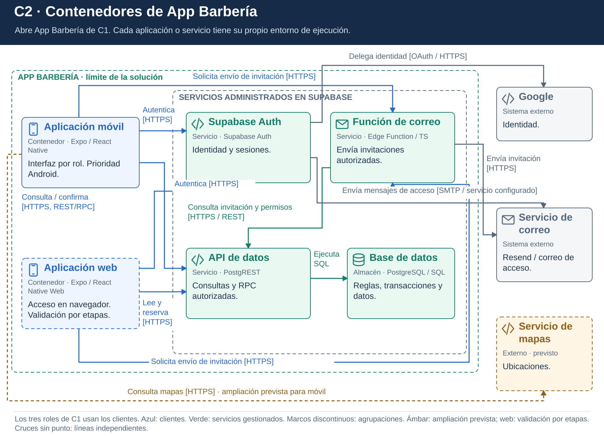

# C2. Contenedores

## Objetivo

Abrir el sistema de C1 y mostrar aplicaciones, servicios de ejecución y almacenamiento. En C4, contenedor no significa Docker: representa una aplicación o almacén con una responsabilidad técnica definida.

## Elementos del sistema

| Contenedor o servicio | Tecnología | Responsabilidad |
|---|---|---|
| Aplicación móvil / Web | Expo, React Native, TypeScript | Interfaz, navegación, coordinación de casos de uso y adaptadores. Android es la prioridad; web e iOS se validarán por etapas. |
| Auth | Supabase Auth | Identidad, sesiones y recuperación; la autorización por barbería depende de membresías y recursos. |
| API de datos | Supabase / PostgREST | Consultas REST autorizadas e invocación RPC de funciones PostgreSQL. |
| Base de datos y funciones | PostgreSQL | Información persistente, reglas transaccionales, permisos, RLS y restricciones. Incluye tareas internas de recordatorio. |
| Edge Function de correo | TypeScript / Supabase | Validar e integrar el envío de invitaciones mediante el proveedor de correo. |

Se incluyen la configuración, funciones y datos del backend dentro de la solución. Supabase administra su infraestructura; no son servidores propios que debamos desarrollar desde cero.

## Comunicaciones principales

| Origen | Destino | Comunicación y propósito |
|---|---|---|
| Usuario | Aplicación | Interacción móvil o navegador. |
| Aplicación | Auth | HTTPS para acceso y sesión. |
| Aplicación | API | HTTPS con contexto del usuario; REST para consultas y RPC para operaciones de servidor. |
| API | PostgreSQL | SQL y funciones; verificar permisos, ejecutar transacciones y persistir. |
| Aplicación | Edge Function | Invocación HTTPS autorizada para el envío de una invitación registrada. |
| Auth | Google / correo de acceso | Integración de identidad y mensajes de confirmación o recuperación. |
| Edge Function | Correo | HTTPS con credenciales solo en servidor. |
| Aplicación | Mapas, previsto | Consulta de mapas con restricciones del proveedor y ubicación autorizada. |

## Seguridad y consistencia

El dispositivo no contiene claves privilegiadas. Auth identifica a la persona; permisos, RLS y funciones verifican su acceso al recurso y a la barbería. Las funciones privilegiadas incluyen comprobaciones explícitas.

La confirmación de reserva y sus escrituras relacionadas ocurren en una transacción de PostgreSQL. Los avisos internos pueden pertenecer a esa transacción; la entrega externa de correo se ejecuta por separado.

Esta vista refleja ADR-001, ADR-003, ADR-004, ADR-005 y ADR-006. No incluye una API propia Node.js ni caché inicial. El siguiente nivel detalla [los componentes de la aplicación](Nivel3-Diagrama-de-Componentes.md).
