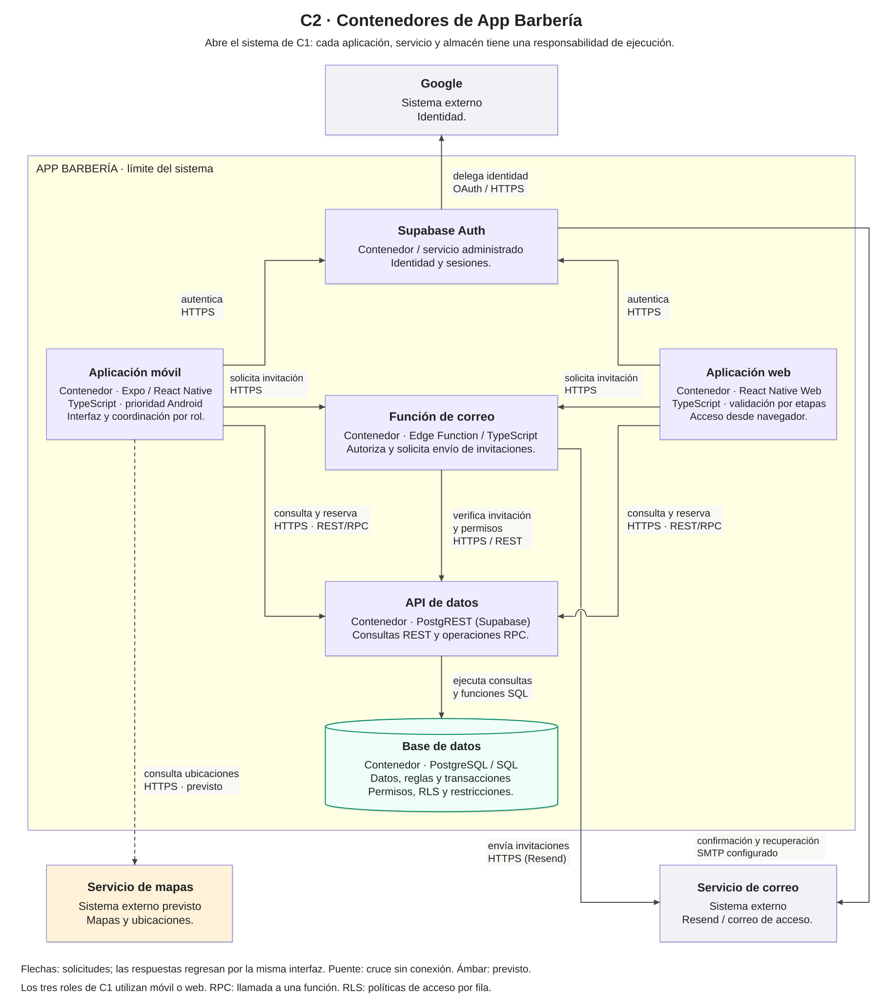
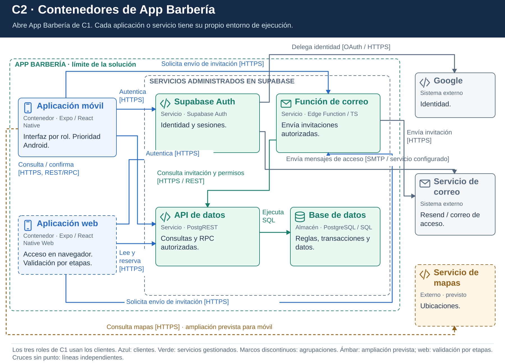

# C2. Contenedores

## Alcance del nivel 2

C1 presenta App Barbería como un único sistema. C2 detalla sus partes principales: la aplicación móvil, la aplicación web, los servicios de Supabase y la base de datos. Muestra qué hace cada parte, qué tecnología utiliza y cómo se comunica con las demás.

En el modelo C4, **contenedor** es el nombre de una aplicación, un servicio que ejecuta operaciones o un almacén de datos. Por ejemplo, la aplicación móvil y PostgreSQL son contenedores distintos porque cumplen responsabilidades diferentes y se ejecutan en entornos separados. El término no exige usar Docker ni adoptar microservicios.

## Diagrama

Las dos imágenes representan el mismo alcance con distribuciones y colores diferentes. Cada una incluye su propia leyenda.

En el primer diagrama, móvil y web aparecen a los lados de los servicios de Supabase. Desde cada cliente se puede seguir la autenticación, la solicitud de invitaciones y las consultas o reservas. Las etiquetas indican la operación y su protocolo. REST permite consultar o modificar datos mediante la API; RPC permite solicitar la ejecución de una función, como `create_reservation`, para confirmar una reserva completa. Ambas formas de acceso usan HTTPS. Los puentes indican cruces de líneas sin conexión.

En la segunda imagen, las conexiones se distinguen además por color y por los números 1 (identidad), 2 (consultas y reservas) y 3 (invitaciones). Esos números identifican relaciones; no son pasos que deban ejecutarse en ese orden.

## Contenedores y servicios

| Nombre del diagrama | Tecnología | Responsabilidad |
|---|---|---|
| Aplicación móvil | Expo, React Native, TypeScript | Presentación y coordinación por rol. Se prioriza Android. |
| Aplicación web | Expo / React Native Web, TypeScript | Acceso desde navegador, con validación por etapas. |
| Supabase Auth | Supabase Auth | Identidad, acceso y sesiones. |
| API de datos | PostgREST administrado por Supabase | Consultas REST y RPC con el contexto autorizado. |
| Función de correo | Supabase Edge Functions, TypeScript | Verifica la invitación y la autorización e integra su envío. |
| Base de datos | PostgreSQL y SQL | Datos de aplicación, reglas, transacciones, permisos y restricciones. |

Móvil y web pueden compartir código, pero se representan por separado porque se ejecutan en entornos diferentes. Los servicios Supabase pertenecen al alcance técnico de la solución y se agrupan como infraestructura administrada. La vista no pretende describir todos los procesos internos del proveedor.

## Relaciones principales

| Origen | Destino | Intención e interfaz |
|---|---|---|
| Ambos clientes | Supabase Auth | Autenticación y sesión por HTTPS. |
| Ambos clientes | API de datos | Consultar y confirmar operaciones mediante HTTPS, REST/RPC y sesión del usuario. |
| API de datos | Base de datos | Ejecutar SQL y funciones transaccionales. |
| Ambos clientes | Función de correo | Solicitar el envío de una invitación registrada por HTTPS. |
| Función de correo | API de datos | Consultar invitación, membresía y establecimiento antes de enviar. |
| Supabase Auth | Google | Delegar identidad mediante OAuth/HTTPS. |
| Supabase Auth | Servicio de correo | Enviar confirmación y recuperación por el mecanismo de correo configurado. |
| Función de correo | Servicio de correo | Enviar invitaciones con Resend mediante HTTPS. |
| Aplicación móvil, por etapas | Servicio de mapas | Consultar mapas y ubicaciones autorizadas por HTTPS. |

Los tres roles de C1 utilizan los clientes según sus permisos. La API rechaza accesos indebidos y PostgreSQL confirma la reserva y sus escrituras relacionadas dentro de una transacción. No se añaden API propia Node.js, pasarela automática ni caché inicial.

En la segunda imagen, los marcos discontinuos delimitan grupos. El acceso web se valida por etapas; mapas aparece en ámbar como ampliación. El siguiente nivel describe los componentes internos de la [Aplicación móvil](Nivel3-Diagrama-de-Componentes.md).
