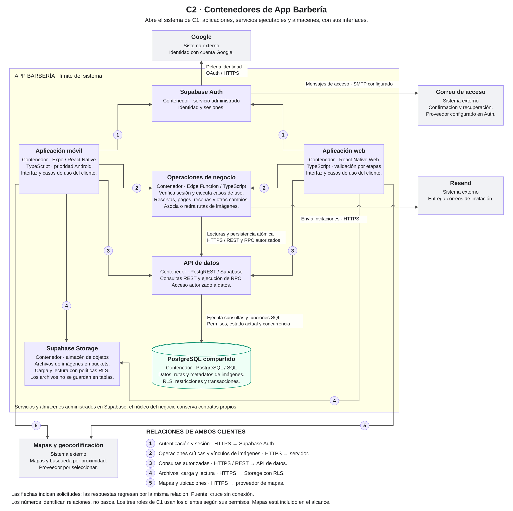
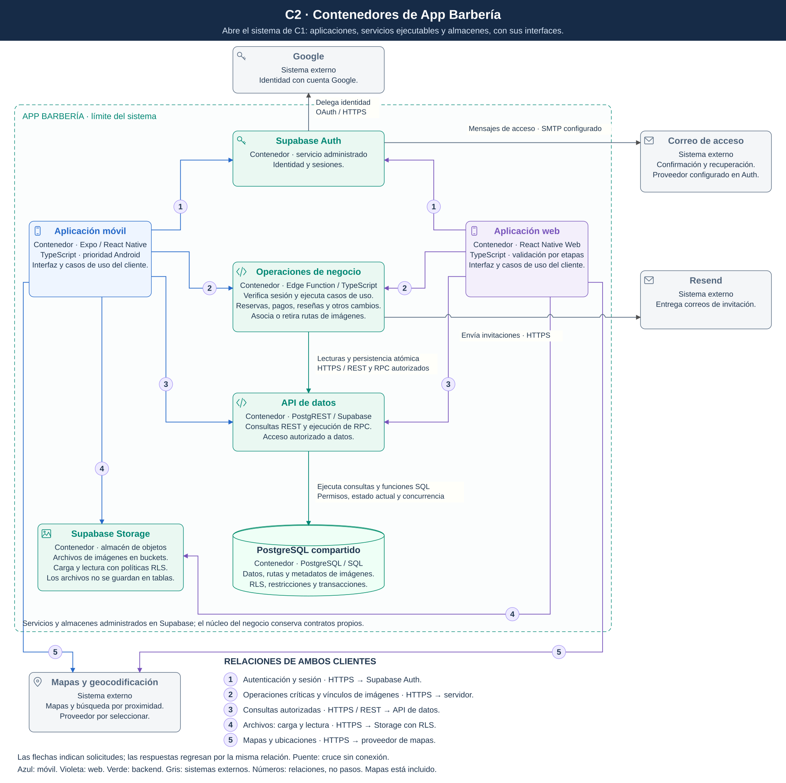

# C2. Contenedores

## Alcance del nivel 2

C1 presenta App Barbería como un único sistema. C2 abre ese límite y muestra sus aplicaciones cliente, servicios de ejecución y almacenes. También indica cómo se comunican con Google, Resend, el correo de acceso y el proveedor de mapas.

En el modelo C4, **contenedor** es una aplicación, un servicio ejecutable o un almacén de datos. La aplicación móvil, las operaciones de negocio en Edge Functions y PostgreSQL tienen responsabilidades y entornos de ejecución distintos. Este término no exige Docker ni microservicios.
## Diagrama

Las dos imágenes representan el mismo alcance con distribuciones y colores diferentes. Cada una incluye su propia leyenda.

En el primer diagrama, móvil y web aparecen a los lados de los servicios administrados. Los números 1 a 5 identifican las relaciones de ambos clientes: autenticación, operaciones críticas, consultas, imágenes y mapas. Las consultas autorizadas utilizan HTTPS y REST; la confirmación de una reserva llega por HTTPS a la Edge Function. Desde allí, el adaptador del caso de uso invoca por RPC una función PostgreSQL mediante la API de datos para la escritura atómica. Los puentes indican cruces de líneas sin conexión.

La segunda imagen muestra las mismas relaciones con conexiones azules para móvil y violetas para web. Los números identifican interfaces, no pasos que deban ejecutarse en ese orden. Ambos diagramas incluyen Supabase Storage para los archivos de imagen; PostgreSQL conserva sus rutas, metadatos y relaciones con los datos del negocio.

## Contenedores y servicios

| Nombre del diagrama | Tecnología | Responsabilidad |
|---|---|---|
| Aplicación móvil | Expo, React Native, Expo Router y TypeScript | Pantallas y casos de uso del cliente por rol. Se prioriza Android. |
| Aplicación web | Expo / React Native Web y TypeScript | Pantallas y casos de uso del cliente en navegador, con validación por etapas. |
| Supabase Auth | Supabase Auth | Identidad, acceso y sesiones. |
| Operaciones de negocio | Supabase Edge Function y TypeScript | Verifica la sesión y ejecuta casos de uso de servidor para reservas, pagos, reseñas e invitaciones; autoriza asociar, reemplazar o retirar las referencias de imágenes de los recursos del negocio. Usa contratos y adaptadores. |
| API de datos | PostgREST administrado por Supabase | Atiende consultas REST autorizadas y ejecuta funciones PostgreSQL por RPC para los adaptadores del servidor. |
| Base de datos | PostgreSQL y SQL | Datos compartidos por barbería, rutas y metadatos de imágenes, RLS, restricciones y transacciones. |
| Supabase Storage | Almacenamiento de objetos administrado | Guarda los archivos de imagen en buckets con políticas de acceso. |

Móvil y web pueden compartir código, pero se representan por separado porque se ejecutan en entornos diferentes. Los servicios Supabase pertenecen al alcance técnico de la solución y se agrupan como infraestructura administrada. La vista no pretende describir todos los procesos internos del proveedor.

## Relaciones principales

| Origen | Destino | Intención e interfaz |
|---|---|---|
| Ambos clientes | Supabase Auth | Autenticación y sesión por HTTPS. |
| Ambos clientes | Operaciones de negocio | Solicitar por HTTPS y con sesión las operaciones críticas, incluida la confirmación de reservas, las invitaciones y la asociación, reemplazo o retiro de referencias de imágenes. |
| Ambos clientes | API de datos | Realizar consultas autorizadas por HTTPS y REST. |
| Ambos clientes | Supabase Storage | Transferir y consultar archivos de imagen por HTTPS. Las políticas de Storage autorizan cada operación sobre el archivo según usuario, barbería, recurso y visibilidad. |
| Ambos clientes | Servicio de mapas | Consultar mapas y ubicaciones por HTTPS para búsqueda por proximidad; proveedor por seleccionar. |
| Operaciones de negocio | API de datos | Consultar datos autorizados por REST e invocar por RPC las funciones PostgreSQL que garantizan escrituras atómicas. |
| API de datos | Base de datos | Ejecutar consultas y funciones SQL con permisos, restricciones y transacciones. |
| Supabase Auth | Google | Delegar identidad mediante OAuth/HTTPS. |
| Supabase Auth | Correo de acceso | Enviar mensajes de confirmación y recuperación mediante el proveedor configurado. |
| Operaciones de negocio | Resend | Enviar invitaciones autorizadas por HTTPS, fuera de la transacción principal. |

Los tres roles de C1 utilizan los clientes según sus permisos. La Edge Function verifica la sesión y coordina los casos de uso; PostgreSQL vuelve a comprobar las condiciones vigentes y conserva las escrituras relacionadas de una reserva dentro de una transacción. La consulta de disponibilidad del cliente es orientativa hasta confirmar. El núcleo del negocio no depende del SDK, de PostgREST ni de SQL. Esta propuesta no añade una API propia Node.js ni una pasarela de pago.

## Recorrido de las imágenes

Las relaciones 2 y 4 cumplen responsabilidades distintas:

1. El adaptador del cliente carga el archivo directamente en Storage con la sesión del usuario, por una ruta nueva asociada a la barbería y al recurso. Las políticas de Storage comprueban el permiso de carga; la lectura respeta la visibilidad definida.
2. El cliente solicita por la relación 2 asociar esa ruta a una barbería, servicio o estilo. La entrada de la Edge Function verifica la sesión; el caso de uso comprueba membresía activa, rol, recurso y pertenencia del archivo antes de registrar la referencia y los metadatos en PostgreSQL mediante su adaptador.
3. Para reemplazar una imagen, se carga un archivo nuevo y el servidor autoriza el cambio de referencia. Para retirarla, el servidor autoriza quitar la referencia. El archivo anterior se elimina mediante la API de Storage cuando ya no esté referenciado y sus políticas permitan la operación.

Cargar un archivo no lo publica automáticamente en el catálogo. Storage controla el acceso al archivo; el caso de uso del servidor autoriza su relación con el negocio. Los clientes no pueden escribir directamente esas referencias en PostgreSQL. Storage y PostgreSQL no comparten una transacción: ante un fallo se conserva la referencia anterior hasta confirmar el cambio y se contempla limpieza controlada de archivos sin referencia.

Los marcos discontinuos delimitan el sistema; no representan contenedores adicionales. El acceso web se valida por etapas. Mapas forma parte del alcance aunque el proveedor concreto está pendiente de selección. El siguiente nivel abre los componentes internos de la [Aplicación móvil](Nivel3-Diagrama-de-Componentes.md).
