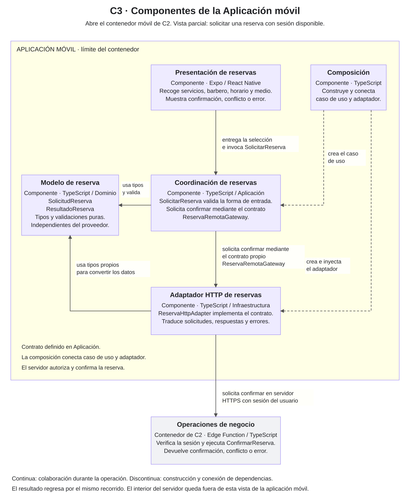
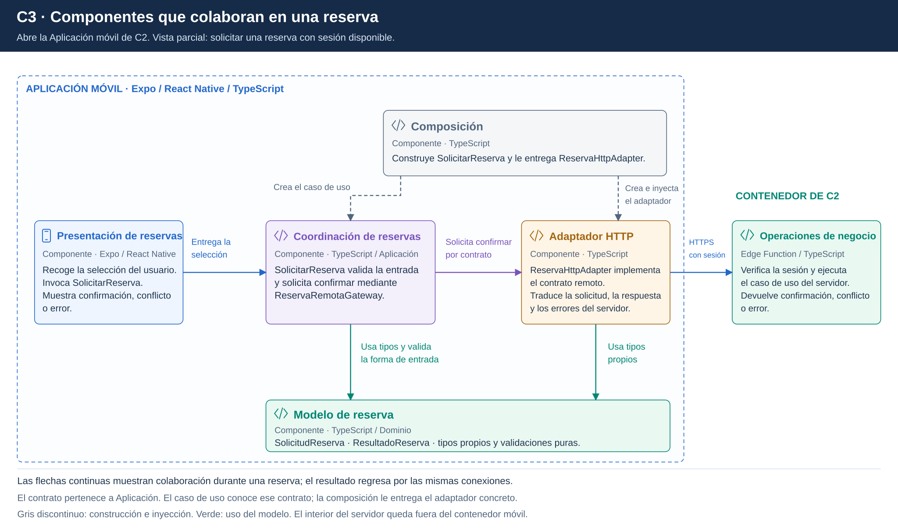

# C3. Componentes de la aplicación móvil

## Alcance

C3 abre únicamente el contenedor **Aplicación móvil** de [C2](Nivel2-DiagramadeContenedores.md). Muestra los componentes que intervienen cuando un cliente solicita una reserva con una sesión disponible. La operación de negocio del servidor se dibuja fuera del límite móvil para identificar la integración; sus componentes internos no forman parte de esta vista. El servidor vuelve a comprobar la identidad, los permisos y la disponibilidad antes de confirmar.

## Diagramas

Ambas imágenes muestran los mismos componentes del cliente con distinta distribución visual. Las flechas continuas indican colaboración durante la solicitud; las discontinuas, construcción e inyección al iniciar el flujo. Una llamada mediante un contrato no significa que el caso de uso importe el adaptador concreto.

## Componentes y responsabilidades

| Componente | Responsabilidad |
|---|---|
| Presentación de reservas | Recoge servicios, barbero, horario y medio de pago; invoca el caso de uso y muestra confirmación o conflicto. |
| Coordinación de reservas | Contiene `SolicitarReserva`: prepara la solicitud y pide la operación remota mediante el contrato propio `ReservaRemotaGateway`. |
| Modelo de reserva | Define `SolicitudReserva`, `ResultadoReserva` y validaciones puras de entrada, sin tipos de Supabase ni formatos de tablas. |
| Adaptador HTTP de reservas | `ReservaHttpAdapter` implementa el contrato, convierte solicitud y respuesta y llama por HTTPS a la operación crítica con la sesión del usuario. |
| Composición | Construye el caso de uso y le entrega una implementación de su contrato al iniciar el flujo. |

Estos nombres describen la organización propuesta; no indican que ya existan archivos con esos nombres. **Operaciones de negocio** es el contenedor de C2 ejecutado como Edge Function en Supabase, fuera de la aplicación móvil.

## Relaciones y recorrido

1. La presentación entrega la selección a `SolicitarReserva`.
2. El caso de uso utiliza los tipos y validaciones del modelo, y solicita la confirmación por `ReservaRemotaGateway`.
3. La composición conecta ese contrato con `ReservaHttpAdapter`. Durante la ejecución, el adaptador envía la solicitud por HTTPS a la Edge Function y traduce su respuesta a `ResultadoReserva`.
4. En el servidor se verifica la sesión y se ejecuta `ConfirmarReserva`. La comprobación definitiva de permisos, disponibilidad y conflictos ocurre allí y en PostgreSQL; la respuesta vuelve por la misma relación hasta la pantalla.

La **dependencia de código** del caso de uso apunta al contrato propio, no al adaptador ni al SDK. La **secuencia de ejecución** sí pasa por el adaptador. El móvil no invoca directamente la función PostgreSQL de confirmación por RPC. Esta separación concreta [Clean Architecture](../02-arquitectura-software/enfoque-arquitectonico.md), ADR-002, ADR-003 y ADR-006, y contribuye a RF13, RF14 y RF42.

[C4](Nivel4-DiagramadeCodigo.md) abre el código de Coordinación de reservas; el modelo y el adaptador siguen siendo componentes vecinos de C3.
