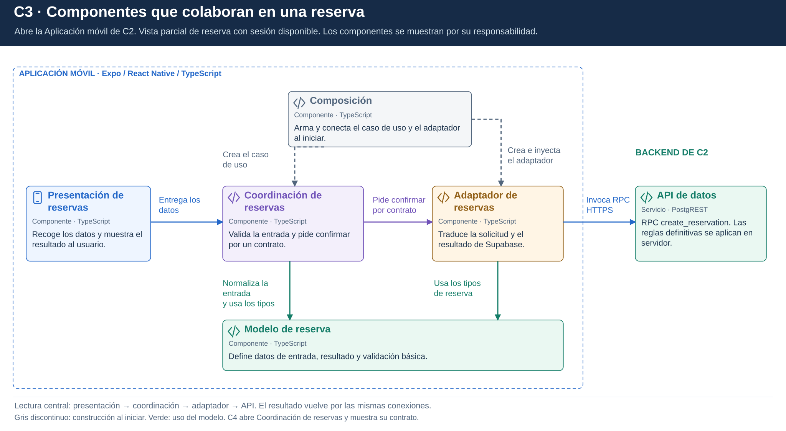

# C3. Componentes

## Contenedor que se abre

Se abre la **Aplicación móvil** de C2, con foco en confirmar una reserva. Es una vista parcial: la sesión ya está disponible y otras funcionalidades permanecen fuera del detalle. Los componentes son agrupaciones de código con una responsabilidad e interfaz reconocibles.

## Lectura del diagrama

La fila central se lee de izquierda a derecha: **Presentación de reservas** recoge los datos, **Coordinación de reservas** valida la entrada y pide confirmar, **Adaptador de reservas** traduce la solicitud y la **API de datos** la recibe en el backend. El resultado vuelve a la presentación por esas mismas conexiones.

Arriba, **Composición** construye y conecta el caso de uso y el adaptador al iniciar. Abajo, **Modelo de reserva** aporta los tipos de entrada, el resultado y la validación básica. El marco azul contiene los componentes de la aplicación móvil; la API permanece fuera porque se ejecuta en servidor.

## Componentes

| Nombre del diagrama | Responsabilidad | Correspondencia del ejemplo técnico |
|---|---|---|
| Presentación de reservas | Recoger selección y mostrar el resultado. | presentacion/demo.ts representa la entrada/salida; la pantalla móvil se plantea en el diseño. |
| Coordinación de reservas | Validar la entrada y solicitar una confirmación completa mediante un contrato. | CrearReserva y ReservaTransaccionalGateway, en aplicacion/. |
| Modelo de reserva | Definir entrada, resultados y normalización sin SDK. | SolicitudReserva, ResultadoReserva y normalizarSolicitud, en dominio/reserva.ts. |
| Adaptador de reservas | Implementar el contrato y convertir parámetros y errores de la RPC. | SupabaseReservaAdapter, en infraestructura/. |
| Composición | Construir el caso de uso y conectar su implementación. | crearFlujoReserva, en composicion.ts. |

La **API de datos** es el mismo servicio PostgREST de C2. Se coloca fuera del marco de la Aplicación móvil porque su ejecución corresponde al backend administrado.

## Relaciones y contrato

- Presentación de reservas invoca CrearReserva.
- Coordinación de reservas usa el Modelo de reserva y declara ReservaTransaccionalGateway.
- La coordinación solicita confirmar mediante el contrato. Adaptador de reservas lo implementa y usa los tipos de dominio; el caso de uso no importa el adaptador concreto.
- Composición construye e inyecta el adaptador en el caso de uso.
- El adaptador invoca create_reservation mediante HTTPS/RPC con la sesión del usuario.

Las flechas centrales muestran uso de servicios entre componentes. La flecha violeta hacia el adaptador representa una llamada a través del contrato, no una importación de su clase concreta. Las líneas grises discontinuas muestran construcción y las verdes, uso del modelo. C4 detalla la interfaz y la clase que la implementa; la secuencia complementaria desarrolla las llamadas y respuestas en el tiempo.

Esta separación responde a ADR-002, ADR-006 y ADR-010 y apoya RF13, RF14 y RF42. El nivel siguiente abre **Coordinación de reservas**; conserva Modelo de reserva y Adaptador de reservas como [componentes vecinos en C4](Nivel4-DiagramadeCodigo.md).
