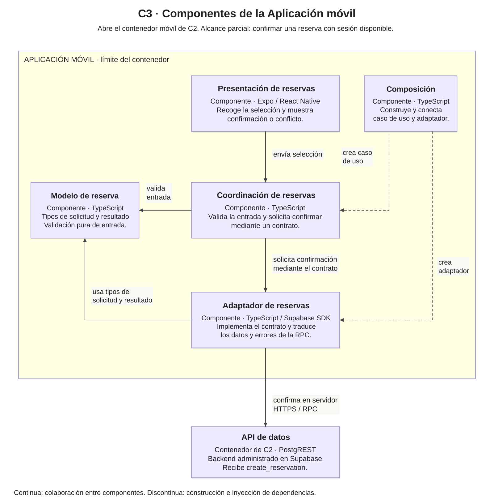
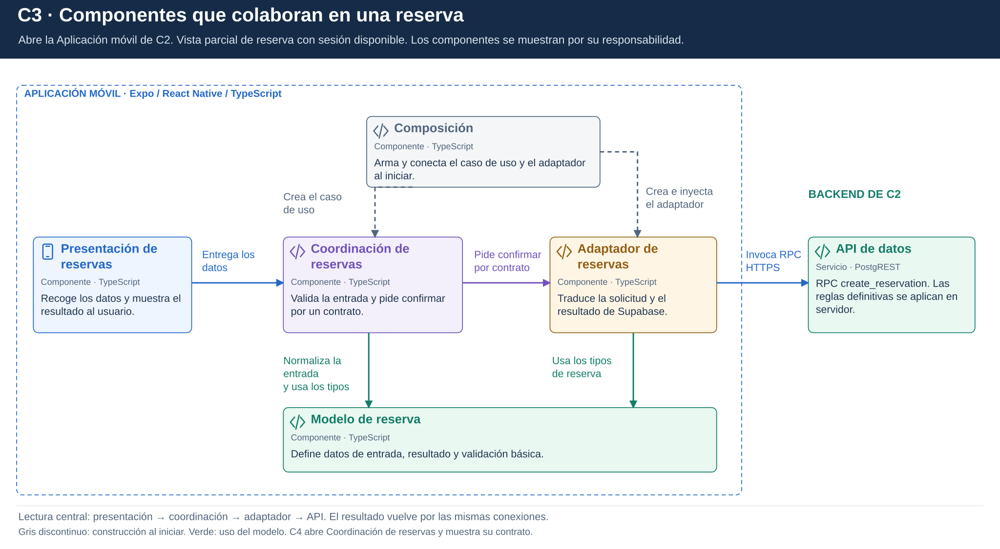

# C3. Componentes

## Alcance del nivel 3

C3 detalla el interior de la **Aplicación móvil** presentada en C2. Se concentra en confirmar una reserva y supone que el usuario ya tiene una sesión válida. Cada componente agrupa código con una responsabilidad concreta, como recoger la selección, coordinar la reserva o comunicarse con Supabase.

## Diagrama

Las dos imágenes representan el mismo alcance con distribuciones y colores diferentes. Cada una incluye su propia leyenda.

## Lectura del diagrama

El recorrido principal es **Presentación de reservas → Coordinación de reservas → Adaptador de reservas → API de datos**. La presentación recoge la selección; la coordinación valida la entrada y solicita confirmar mediante un contrato; el adaptador convierte los datos y llama a la API. El resultado regresa por esas mismas conexiones. Este recorrido se lee de arriba hacia abajo en el primer diagrama y de izquierda a derecha en la segunda imagen.

**Composición** construye el caso de uso y le entrega el adaptador al iniciar el flujo. **Modelo de reserva** aporta los tipos de entrada, el resultado y la validación básica. Ambos pertenecen a la aplicación móvil. La API permanece fuera de su marco porque se ejecuta en el backend de Supabase.

## Componentes

| Nombre del diagrama | Responsabilidad | Correspondencia del ejemplo técnico |
|---|---|---|
| Presentación de reservas | Recoger selección y mostrar el resultado. | presentacion/demo.ts representa la entrada/salida; la pantalla móvil se plantea en el diseño. |
| Coordinación de reservas | Validar la entrada y solicitar una confirmación completa mediante un contrato. | CrearReserva y ReservaTransaccionalGateway, en aplicacion/. |
| Modelo de reserva | Definir entrada, resultados y normalización sin SDK. | SolicitudReserva, ResultadoReserva y normalizarSolicitud, en dominio/reserva.ts. |
| Adaptador de reservas | Implementar el contrato y convertir parámetros y errores de la RPC. | SupabaseReservaAdapter, en infraestructura/. |
| Composición | Construir el caso de uso y conectar su implementación. | crearFlujoReserva, en composicion.ts. |

La **API de datos** es el mismo servicio PostgREST de C2. Se coloca fuera del marco de la Aplicación móvil porque su ejecución corresponde al backend administrado.

## Relaciones y contrato

- Presentación de reservas invoca CrearReserva.
- Coordinación de reservas usa el Modelo de reserva y declara ReservaTransaccionalGateway.
- La coordinación solicita confirmar mediante el contrato. Adaptador de reservas lo implementa y usa los tipos de dominio; el caso de uso no importa el adaptador concreto.
- Composición construye e inyecta el adaptador en el caso de uso.
- El adaptador invoca create_reservation mediante HTTPS/RPC con la sesión del usuario.

La conexión entre Coordinación y Adaptador representa una llamada a través del contrato; no significa que el caso de uso importe la clase concreta del adaptador. Las líneas discontinuas representan construcción e inyección de dependencias, es decir, entregar a un objeto la implementación que necesita. C4 detalla la interfaz y la clase que la implementa; la secuencia complementaria muestra el orden de las llamadas y respuestas.

Esta separación responde a ADR-002, ADR-006 y ADR-010 y apoya RF13, RF14 y RF42. El nivel siguiente detalla el código de **Coordinación de reservas**; conserva Modelo de reserva y Adaptador de reservas como [componentes vecinos en C4](Nivel4-DiagramadeCodigo.md).
