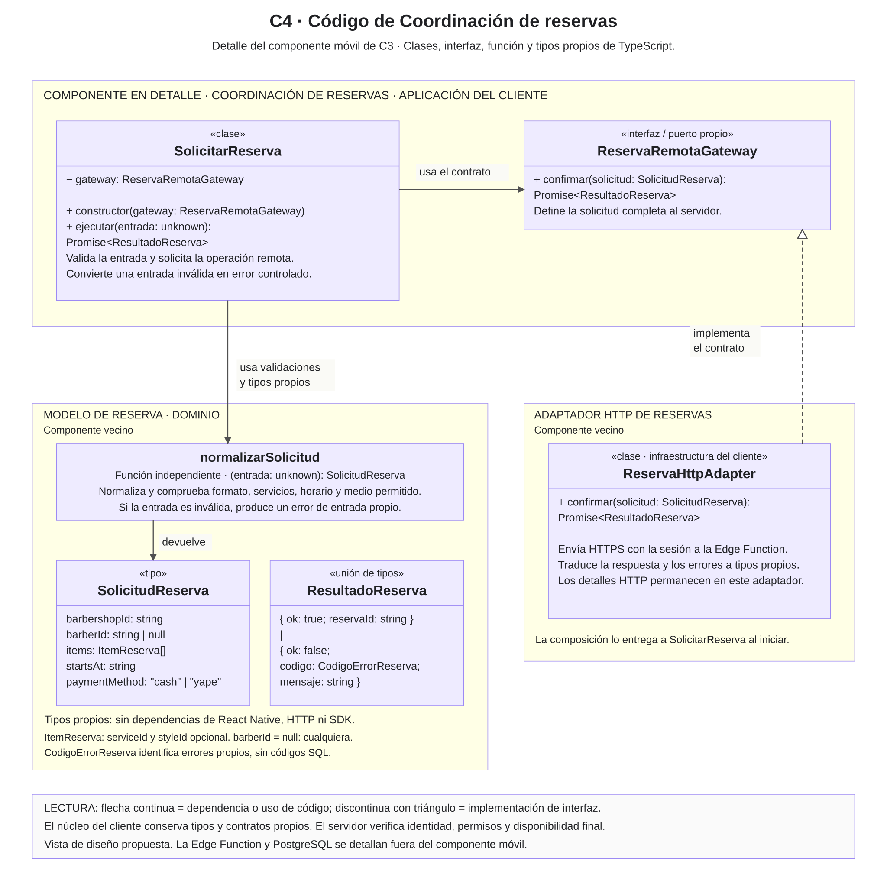
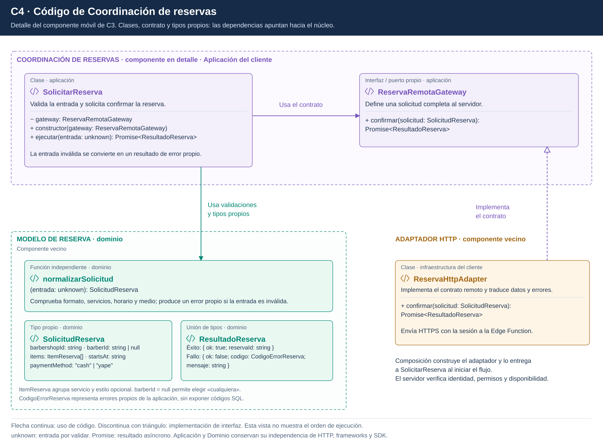
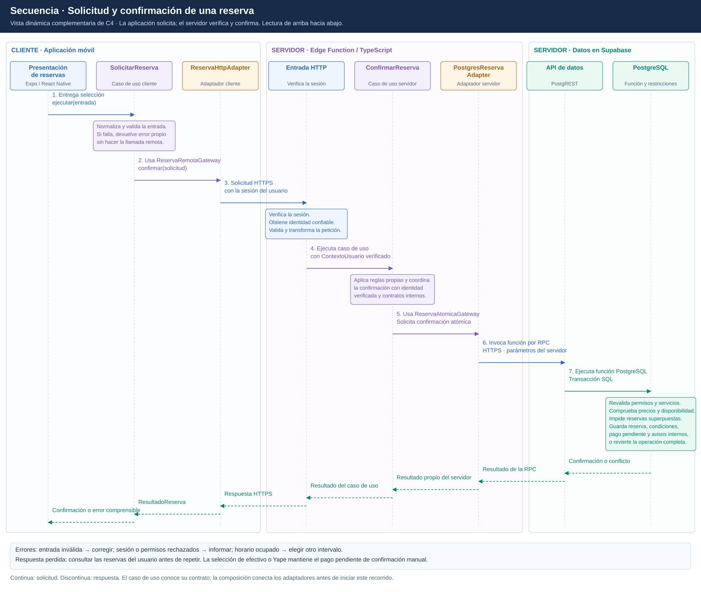

# C4. Código de Coordinación de reservas

## Alcance

C4 detalla el diseño de código del componente **Coordinación de reservas** de la aplicación móvil presentado en [C3](Nivel3-Diagrama-de-Componentes.md). Este componente contiene la clase `SolicitarReserva` y el contrato propio `ReservaRemotaGateway`. Los grupos vecinos muestran los tipos y validaciones del Modelo de reserva y la implementación del Adaptador HTTP de reservas.

Los nombres y las firmas expresan la propuesta de diseño. Su ubicación corresponde a responsabilidades de aplicación, dominio e infraestructura, sin fijar rutas de archivos ni afirmar una implementación existente. La misma regla de dependencias se aplicará desde el inicio en cliente y servidor.

## Diagramas de código

Ambas imágenes representan el mismo alcance. Las relaciones muestran qué código utiliza un contrato, una función o un tipo. El orden de llamadas durante una reserva se explica en la secuencia complementaria.

## Elementos y responsabilidades

| Elemento | Tipo y responsabilidad | Ubicación lógica |
|---|---|---|
| `SolicitarReserva` | Clase que recibe el contrato, normaliza la entrada y solicita la operación remota. Su método `ejecutar(entrada: unknown): Promise<ResultadoReserva>` devuelve confirmación o error controlado. | Aplicación del cliente: Coordinación de reservas. |
| `ReservaRemotaGateway` | Interfaz que define `confirmar(solicitud: SolicitudReserva): Promise<ResultadoReserva>`. Expresa una solicitud completa al servidor, sin exponer operaciones de tablas o parámetros SQL. | Aplicación del cliente: Coordinación de reservas. |
| `normalizarSolicitud` | Función independiente que comprueba y normaliza la entrada; devuelve `SolicitudReserva` o produce un error de entrada propio que el caso de uso convierte en un resultado controlado. | Dominio del cliente: Modelo de reserva. |
| `SolicitudReserva` | Tipo con `barbershopId`, `barberId`, `items`, `startsAt` y `paymentMethod`. Representa la selección del cliente. | Dominio del cliente: Modelo de reserva. |
| `ItemReserva` | Tipo de cada elemento de `items`: identifica el servicio y su estilo opcional. | Dominio del cliente: Modelo de reserva. |
| `ResultadoReserva` | Unión de tipos: éxito con `ok: true` y `reservaId`, o fallo con `ok: false`, `codigo` y `mensaje`. | Dominio del cliente: Modelo de reserva. |
| `CodigoErrorReserva` | Tipo propio para distinguir errores comprensibles de la aplicación, como entrada inválida, falta de autorización o conflicto de horario. Los adaptadores traducen los errores externos. | Dominio del cliente: Modelo de reserva. |
| `ReservaHttpAdapter` | Clase que implementa el contrato remoto, envía la solicitud por HTTPS con la sesión a la Edge Function y convierte la respuesta a tipos propios. | Infraestructura del cliente: Adaptador HTTP de reservas. |

En la solicitud, `barberId = null` representa la elección «cualquiera»: el servidor determina un barbero elegible antes de confirmar. `startsAt` identifica un instante inequívoco, mostrado en la zona horaria de la barbería. `paymentMethod` admite `cash` o `yape`; el pago se mantiene pendiente hasta que lo confirme manualmente el barbero asignado o un administrador autorizado.

El servidor obtiene la identidad de la sesión verificada y comprueba la barbería, los servicios, los precios y la disponibilidad vigentes. Los identificadores enviados por el cliente no sustituyen esas comprobaciones.

## Lectura de las relaciones

- **Uso del contrato:** `SolicitarReserva` depende de `ReservaRemotaGateway` y de tipos y validaciones propios. La interfaz describe lo que necesita del exterior.
- **Uso del dominio:** `normalizarSolicitud` comprueba la forma de la entrada antes de una llamada remota. Es una función independiente, no un método del tipo `SolicitudReserva`.
- **Implementación del contrato:** la línea discontinua con triángulo apunta de `ReservaHttpAdapter` a `ReservaRemotaGateway`. El caso de uso conserva una referencia al contrato; la composición le entrega el adaptador concreto al iniciar el flujo.

`unknown` indica una entrada aún por validar. `Promise<ResultadoReserva>` indica que el resultado se obtiene de forma asíncrona. Los tipos utilizados en las firmas pertenecen al núcleo del cliente; los detalles de HTTP, los frameworks y el SDK quedan fuera de aplicación y dominio.

## Secuencia complementaria

Esta vista dinámica amplía el recorrido hasta el servidor. Sus participantes son:

1. **Presentación de reservas:** entrega la selección y muestra el resultado.
2. **SolicitarReserva:** valida la entrada y solicita la operación mediante `ReservaRemotaGateway`.
3. **ReservaHttpAdapter:** envía la solicitud y la sesión por HTTPS.
4. **Entrada HTTP de la Edge Function:** verifica la sesión, transforma la petición y entrega un contexto de usuario confiable al caso de uso.
5. **ConfirmarReserva:** coordina las reglas propias del servidor y solicita la confirmación mediante `ReservaAtomicaGateway`.
6. **PostgresReservaAdapter:** implementa el contrato atómico e invoca una función PostgreSQL mediante PostgREST RPC; convierte parámetros, respuestas y errores externos.
7. **API de datos — PostgREST:** ejecuta la función solicitada por RPC.
8. **PostgreSQL:** comprueba el estado vigente, los permisos y la disponibilidad; impide intervalos incompatibles y guarda las escrituras relacionadas en una transacción, o revierte la operación completa.

La respuesta vuelve por el mismo recorrido. Las líneas continuas de esta secuencia indican solicitudes; las discontinuas indican respuestas. Aquí la RPC parte del adaptador del servidor. El cliente llama a la Edge Function para esta operación crítica.

La transacción conserva la reserva, sus condiciones históricas, el pago pendiente y los avisos internos relacionados. La selección de un medio de pago no acredita su recepción; las entregas externas, como el correo, se realizan fuera de la transacción principal.

| Situación | Comportamiento esperado |
|---|---|
| Entrada inválida | Devuelve un error comprensible sin enviar una solicitud remota innecesaria. El servidor también valida lo recibido. |
| Sesión o permisos rechazados | Rechaza la operación sin exponer datos privados. |
| Horario ocupado | Devuelve un conflicto y permite elegir otro intervalo. Los códigos de PostgreSQL se traducen en infraestructura. |
| Confirmación | Muestra el identificador de reserva y mantiene el estado de pago pendiente. |
| Respuesta perdida | Consulta las reservas del usuario antes de repetir la solicitud; no reintenta automáticamente una escritura cuyo resultado se desconoce. |

Las pruebas unitarias verificarán los casos de uso del cliente y del servidor con adaptadores de prueba. Las pruebas de integración comprobarán sesión, permisos, transacción y concurrencia según EQ-01, EQ-02 y EQ-03 de los [escenarios de calidad](../01-analisis-de-sistema/08-escenarios-atributos-calidad.md).

Este diseño desarrolla ADR-002, ADR-003, ADR-005, ADR-006 y ADR-010, y se complementa con el [diseño interno de módulos](../03-diseño-de-software/diseño-interno/diseño-interno-de-modulos.md).
