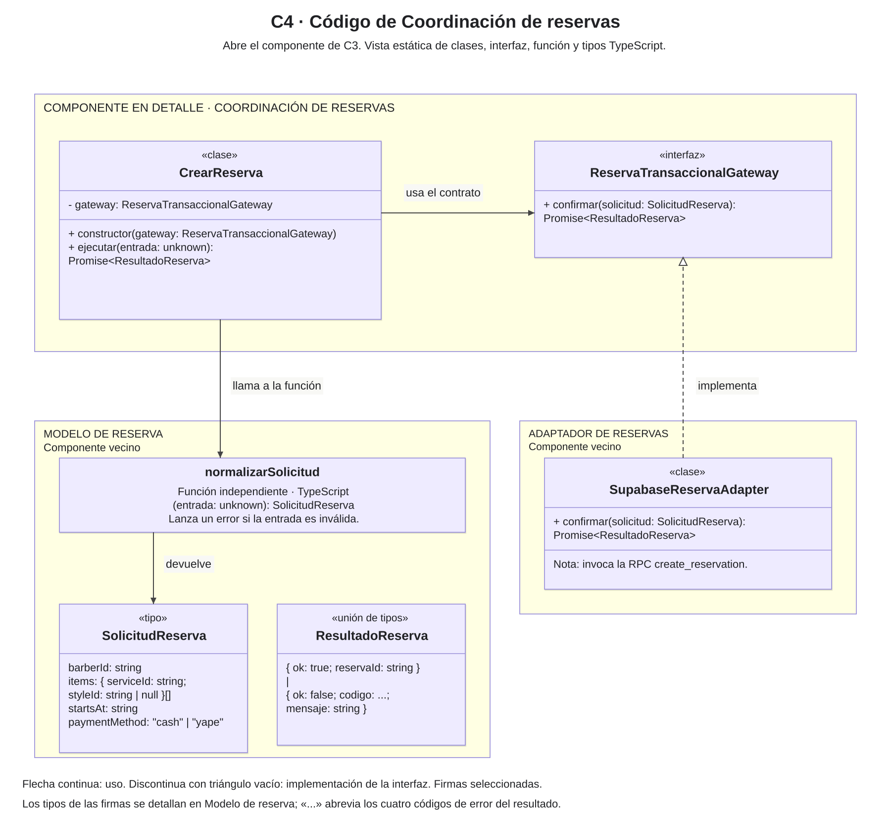
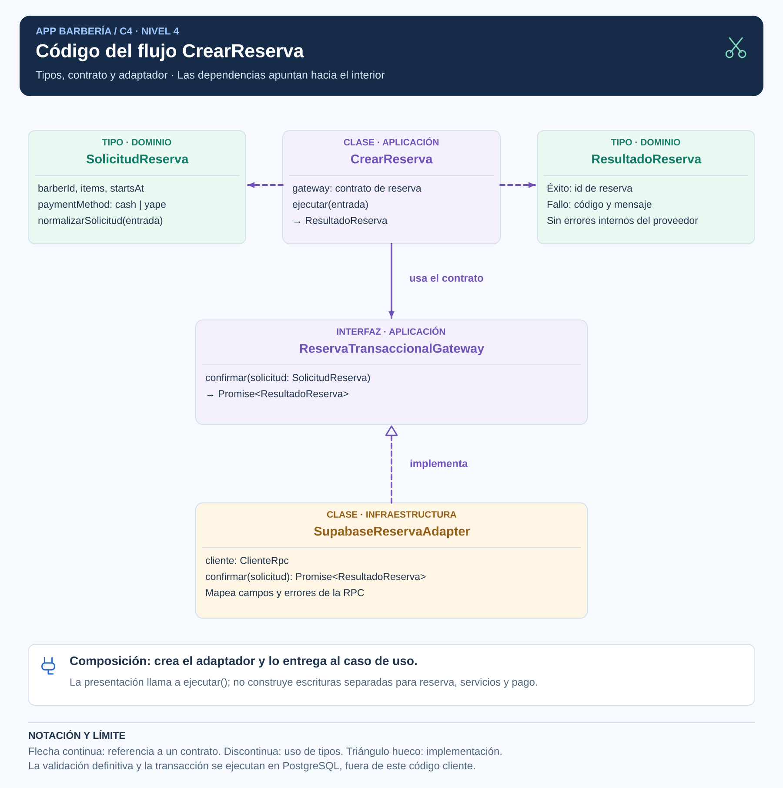
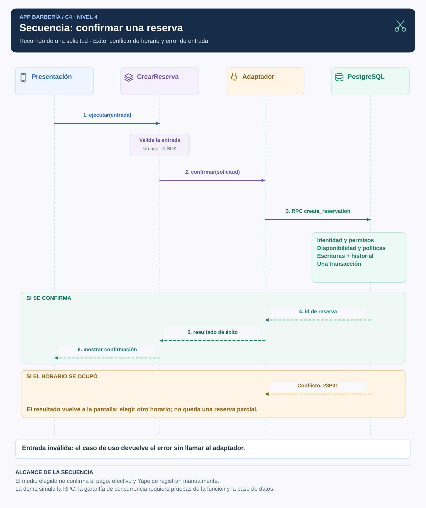

# C4. Código

## Alcance del nivel 4

C4 detalla el código del componente **Coordinación de reservas** presentado en C3. Su grupo contiene la clase `CrearReserva` y la interfaz `ReservaTransaccionalGateway`. Los otros grupos muestran los elementos relacionados del Modelo de reserva y del Adaptador de reservas. Así se distingue qué código pertenece al componente estudiado y qué código utiliza de sus vecinos.

**Diagrama**

Las dos imágenes representan el mismo alcance con distribuciones y colores diferentes. Cada una incluye su propia leyenda.

## Correspondencia con el código

| Elemento | Tipo y ubicación | Responsabilidad |
|---|---|---|
| CrearReserva | Clase de aplicacion/crear-reserva.ts | Recibe el gateway, normaliza la entrada y coordina la confirmación. |
| ReservaTransaccionalGateway | Interfaz de aplicacion/reserva-transaccional.contrato.ts | Define `confirmar(solicitud: SolicitudReserva): Promise<ResultadoReserva>`. |
| SolicitudReserva | Tipo de dominio/reserva.ts | barberId, items, startsAt y paymentMethod. |
| ResultadoReserva | Unión de tipos de dominio/reserva.ts | Éxito con reservaId o fallo con codigo y mensaje. |
| normalizarSolicitud | Función independiente de dominio/reserva.ts | Recibe unknown y devuelve SolicitudReserva o lanza un error de entrada. |
| SupabaseReservaAdapter | Clase del componente Adaptador de reservas | Implementa el gateway y mapea la RPC. |

CrearReserva dispone de un constructor que recibe ReservaTransaccionalGateway. Su método `ejecutar(entrada: unknown)` devuelve `Promise<ResultadoReserva>`. La función normalizarSolicitud no pertenece al tipo SolicitudReserva; se representa por separado.

## Lectura de relaciones

- **CrearReserva usa el contrato:** ReservaTransaccionalGateway define la operación confirmar que necesita el caso de uso. El contrato es una interfaz, no otro servidor.
- **CrearReserva llama a normalizarSolicitud:** la función comprueba formato y datos básicos antes de solicitar la confirmación. Los permisos y la disponibilidad definitiva se comprueban en servidor.
- **SupabaseReservaAdapter implementa el contrato:** la línea discontinua con triángulo apunta a la interfaz que cumple esta clase. Composición construye el adaptador y lo entrega a CrearReserva, como muestra C3.

Las tarjetas SolicitudReserva y ResultadoReserva explican los tipos utilizados en las firmas. `unknown` indica una entrada aún por validar; `Promise<ResultadoReserva>` indica que el resultado se obtiene de forma asíncrona. El diagrama selecciona los elementos relevantes de código; la tabla anterior conserva su ubicación exacta.

## Secuencia complementaria

La secuencia es una vista dinámica adicional, distinta del diagrama estático de código. Incluye presentación, caso de uso, adaptador, API de datos y PostgreSQL. Conserva los nombres de C2 y C3 y permite seguir la solicitud hasta la función create_reservation.

Una entrada inválida evita la llamada remota. Un conflicto 23P01 informa horario ocupado. Si se pierde la respuesta, se consultan las citas antes de reenviar. La demo simula el servidor; permisos y concurrencia reales se verificarán mediante EQ-01, EQ-02 y EQ-03. Elegir cash o yape no confirma recepción del pago.

El [diseño interno](../03-diseño-de-software/diseño-interno/diseño-interno-de-modulos.md) y la [demostración técnica](../../tecnologia/barberia-clean-architecture/README.md) completan esta vista.
